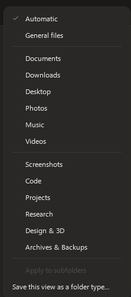
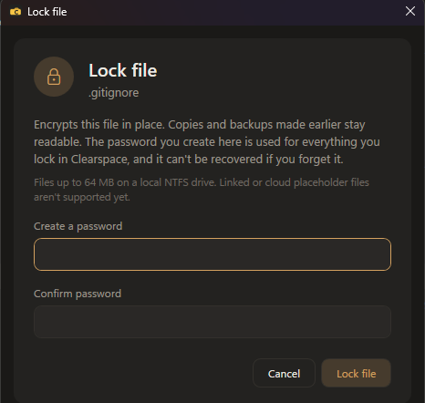
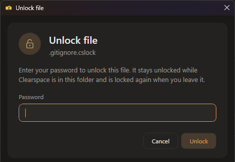
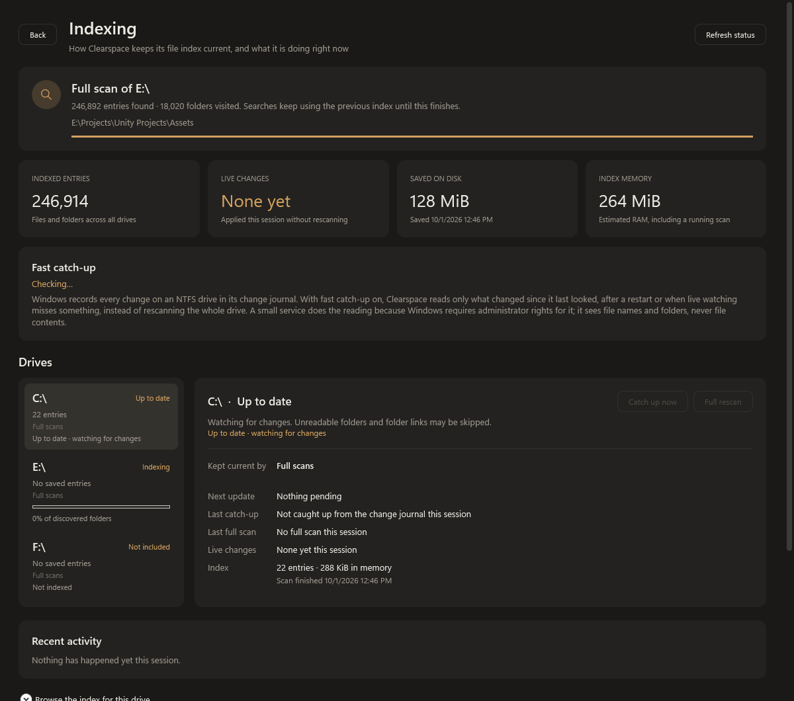
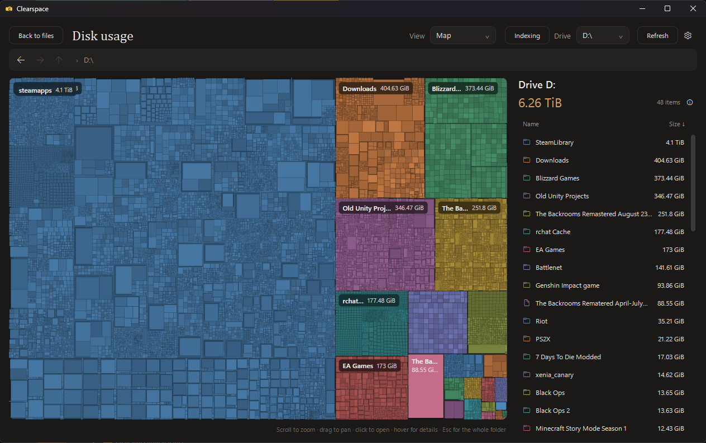
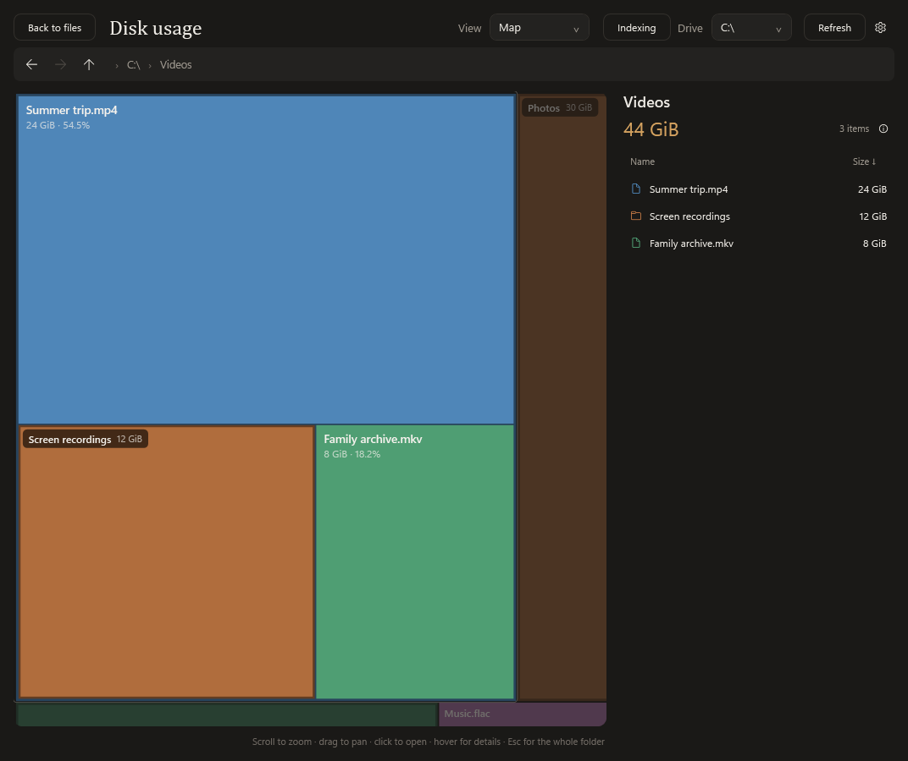
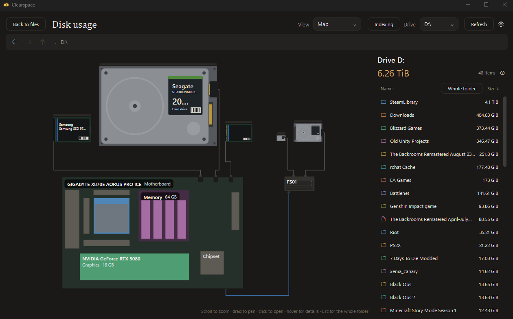
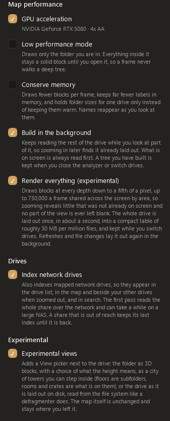

# Clearspace

Clearspace is a modern Windows file manager built to be a comfortable replacement for File Explorer: familiar file operations, a calmer interface, and better ways to organize and find work.

> **Work in progress:** Clearspace is still an early public release. There will be bugs and rough edges as it is used on more Windows setups and file collections. Please report issues you find; fixes and improvements will continue over time.

<!-- CHANGED (user readme): this page is now for the person installing and using Clearspace. Installing
     comes first. Building from source, publishing a release and the project layout moved to
     DEVELOPMENT.md. -->
## Install

1. Download **[ClearspaceSetup.exe](https://github.com/Friday7352/Clearspace/releases/latest/download/ClearspaceSetup.exe)**, the newest release. Earlier versions are on the [Releases page](https://github.com/Friday7352/Clearspace/releases).
2. Run it. Windows may show a blue **Windows protected your PC** notice, because the installer is not signed with a publisher certificate. Choose **More info**, then **Run anyway**.
3. Follow the steps. Setup offers the two options described below.

**What you need:** 64-bit Windows 10 or Windows 11. Nothing else has to be installed first: everything Clearspace uses is inside the setup file or already part of Windows. The setup file works offline and downloads nothing.

**What setup does:** it installs Clearspace for your Windows account only, so it needs no administrator permission, and adds it to the Start menu. Clearspace sits beside File Explorer and does not replace it. Setup offers two options:

- **A desktop shortcut.**
- **Instant indexing** (on by default) installs the Clearspace Index Helper service described under [Instant indexing and fast catch-up](#instant-indexing-and-fast-catch-up). Windows asks for administrator permission once, during setup. You can turn it on or off later from the Indexing page.

<!-- CHANGED (user readme): the in-app update comes first; running a newer setup by hand is the fallback. -->
### Updating

Clearspace updates itself. After the first install nobody has to download the installer by hand:

- **Settings > Check for updates…** looks for a newer release right away.
- **Settings > About Clearspace…** shows the version, where Clearspace and its data are, and the Windows and .NET it runs on, with the same **Check for updates** button and a **Copy details** button for bug reports.
- **Check for updates automatically** (in the About window, on by default) looks quietly a few seconds after Clearspace starts and every 6 hours while it is open. It never interrupts: a newer version shows as an **Update available** chip in the status bar.
- The update dialog shows what changed. **Update now** downloads the installer, checks it against the size and SHA-256 fingerprint GitHub lists for it, runs it with only a progress window, and opens Clearspace again. **Later** keeps the chip; **Skip this version** hides it until something newer is released.

The check is one request to GitHub for the newest Clearspace release. Nothing about your PC is sent beyond what any web request carries. Turn **Check for updates automatically** off in the About window to stop it.

You can also update by hand: download the newer `ClearspaceSetup.exe` and run it. Setup sees the Clearspace that is already installed and opens on a page offering:

- **Update** (or **Repair** when the same version is installed) — replaces the app and keeps settings, tags, the saved index and locked files. Clearspace is closed first; anything unlocked for a visit is locked again before it closes.
- **Update and choose the options again** — the same, plus the page with the desktop shortcut and Instant indexing options.
- **Remove Clearspace** — starts the uninstaller.

Copies of Clearspace older than 1.2.0 have no update check, so they need the newest installer run once by hand.

<!-- NEW (go back) -->
**Going back to an earlier version.** If a new version gives you trouble, **Settings > About Clearspace… > Earlier versions…** lists the releases before the one you have. **Go back to this** downloads that release's installer, checks it the same way an update is checked, and installs it over the current one. Your settings, tags and locked files are kept. Clearspace then stops mentioning the version you left, announces only releases newer than it, and **Settings > Check for updates…** takes you forward again whenever you want. Versions before 1.2.0 are not offered, because they cannot update themselves. If **Open folders with Clearspace** is on and the version you go back to does not have it yet, it is turned off first, so folders open in File Explorer again.

A silent run (`ClearspaceSetup.exe /VERYSILENT`) performs the plain update.

<!-- CHANGED (user readme): says plainly that locked files are left in place; only their icon and
     double-click handling go. -->
### Uninstalling

Uninstall Clearspace from Windows Settings like any other app, or run the setup again and choose **Remove Clearspace**. This closes Clearspace and removes the app, its shortcuts, its entries in Explorer's right-click menu, the lock icon and double-click handling for `.cslock` files, the "Open folders with Clearspace" setting (folders open in File Explorer again), and the Index Helper service (Windows asks for permission once to remove the service).

**Your own files are never removed.** Files you left locked stay where they are, still encrypted. Without Clearspace they show a blank icon and cannot be opened; install Clearspace again and they open with the same password.

Before anything is removed, the uninstaller asks up to two questions:

1. **Locked files** (only when something is still locked): **Remove the locks first** opens Clearspace's *Remove all locks* dialog, which asks for your password and decrypts everything; **Leave them locked** uninstalls anyway.
2. **Your data**: **Keep my data** leaves tags, folder types and settings in `%APPDATA%\Clearspace` and the saved index, lock icons and logs in `%LOCALAPPDATA%\Clearspace` for a later install. **Remove everything** deletes both folders. If items are still locked, the lock records (`tags.db`) and lock icons are kept either way.

A silent uninstall asks nothing and leaves locks and data alone.

<!-- NEW (user readme) -->
### Reporting a problem

**Settings > About Clearspace…** has a **Copy details** button that copies the version and system details. Paste them into a new issue on the [Issues page](https://github.com/Friday7352/Clearspace/issues), with what you were doing when it went wrong.

<!-- NEW (search trace) -->
If searching is slow, attach `search-trace.log` from `%APPDATA%\Clearspace` as well. A search that takes 1.5 seconds or more leaves one line there saying how long each step took, and so does any moment the window stops responding. It holds timings and counts only, never what you typed, and stays on your PC unless you send it.

<!-- NEW: a short list of the recent additions, linking to the sections below. -->
## What's new

<!-- NEW (themes page) -->
- **[A page of themes, each with a preview](#themes)**: Settings > Choose a theme… shows every theme as a small window in its own colors. Click one to use it.
<!-- NEW (zip folders) -->
- **[Open ZIP files like folders](#zip-files)**: double-click a `.zip` to look inside it, and open, copy or drag out what you need without extracting it first.
<!-- NEW (theme files) -->
- **[Add themes, and make your own](#themes)**: every theme is one file in a Themes folder. Import one somebody made from the Settings menu, or make your own from a copy of any theme.
<!-- NEW (live drives) -->
- **[Drives show up as you plug them in](#familiar-file-manager-foundations)**: a USB stick or an external drive appears in the sidebar and on This PC the moment it is connected, and goes when it is taken out.
<!-- NEW (file backup) -->
- **[Backup and restore](#backup-and-restore)**: back up files, folders and whole drives to another place, by hand or on a schedule, as a clone, dated versions or zip files, and get a file's earlier versions back from its right-click menu. Clearspace sees what is in a folder (documents, photos, projects) and sets the options that suit it.
<!-- NEW (backup) -->
- **[Settings and tags backup](#settings-and-tags-backup)**: back up your settings and tags by hand or automatically, and put them back if they are ever lost.
<!-- NEW (menu by type) -->
- **[A right-click menu that fits the file](#familiar-file-manager-foundations)**: play a sound file, view or copy a picture, run a program as administrator, print a document, and more, with cut, copy, paste, rename and delete as a row of icons.
<!-- NEW (map network drive) -->
- **[Map a network drive](#familiar-file-manager-foundations)**: give a shared folder on another computer or a NAS a drive letter, and disconnect it again, without opening File Explorer.
<!-- NEW (drag to select) -->
- **Drag to select**: drag across empty space in the file list to draw a rectangle, and every file it touches is selected, as in File Explorer.
<!-- NEW (duplicates, downloads, scroll while dragging) -->
- **Scroll while dragging**: hold a dragged file near the top or bottom edge of the list, or turn the mouse wheel, and the list scrolls so you can drop it on a folder that was off screen.
- **[Find duplicates](#find-duplicates)**: finds exact copies in any folder and removes the ones you tick, always keeping one.
- **[A Downloads folder that helps](#the-downloads-folder)**: your newest downloads at the top with one-click actions, a way back to the page a file came from, suggested folders for filing, and a list of setup files you no longer need.
<!-- NEW (switching): the four additions made for people moving over from File Explorer. -->
- **Folders stay up to date**: a download that finishes, or a file another program saves, renames or deletes, shows up in the folder you have open without pressing F5.
- **[Preview pane](#preview-pane)**: Alt+P shows the selected picture, text file or ZIP beside the list without opening it.
- **[ZIP files](#zip-files)**: open one like a folder; extract and compress from the right-click menu.
- **[Rename several items at once](#rename-several-items-at-once)**: F2 with more than one item selected, with every new name shown before anything changes.
- **[Open folders with Clearspace](#open-folders-with-clearspace)**: folders from the desktop, other programs and Win+E open in Clearspace.
<!-- NEW (user readme): the 1.3.0 additions. -->
- **[Tabs](#familiar-file-manager-foundations)**: Ctrl+T for a new tab, or middle-click a folder to open it in one. Each tab keeps its own history, search, scroll position and selection.
- **[More than one window](#familiar-file-manager-foundations)**: Ctrl+N or "Open in new window".
- **[Your own folders in Your files](#familiar-file-manager-foundations)**, beside Desktop, Documents and the rest.
- **[Password locks](#password-protected-files-and-folders)** for files and folders, with lock icons and right-click entries in Windows Explorer too.
- **[Folder types](#folder-types-that-adapt-to-your-work)**: thirteen built-in types, types you save yourself, a Projects strip, and Git status in Code folders.
- **[Instant indexing and fast catch-up](#instant-indexing-and-fast-catch-up)**: a drive's first index takes seconds, and reopening Clearspace reads only what changed.
- **[The Indexing page](#see-what-is-indexed)** shows how each drive is kept current and what the index is doing right now.
- **[Disk usage map](#disk-usage-visualizer)**: your drives, motherboard, memory and processor when you zoom out, plus experimental 3D views.
- **Lower memory use**: saving the index no longer copies it, and memory used by a rescan is handed back to Windows.
- **[Themes](#themes)**: six looks to choose from, plus a set of experimental ones that change the icons and fonts too.

## What Clearspace adds

<!-- CHANGED (user readme): notes written for developers were taken out of this section or reworded
     (how tags and locks are stored, how the disk map draws, links to the design notes). The design
     notes are linked from DEVELOPMENT.md. -->

### Folder types that adapt to your work

<!-- CHANGED: every folder type explained in one table (what it opens as, what it adds, and when
     Automatic picks it), with a picture of the menu. -->

Every folder has a type, chosen from the folder type button in the toolbar. The
type decides how the folder opens (tiles or a list), which columns it shows, how
it is sorted and grouped, and which extras it gets, such as the photo viewer or
the music player. A type you choose is saved for that folder.



Leave a folder on **Automatic** and Clearspace picks the type for you. The
toolbar shows what it picked, for example **Auto (Photos)**, or just **Auto**
when nothing in particular fits and the folder opens as General files. It
decides in this order:

1. **Windows' own folders.** Desktop, Documents, Downloads, Pictures, Music,
   Videos and Pictures\Screenshots keep their meaning wherever they have been
   moved to.
2. **The folder's name.** A folder called "Camera roll" opens as Photos, "Old
   backups" as Archives & Backups, and so on.
3. **A code repository.** A `.git` folder, a solution or project file, or a
   package manifest such as `package.json` in the folder or any folder above it.
4. **What the folder contains.** Once a folder has been opened, at least three
   files with most of them (60 %) of one kind decide it: mostly pictures is
   Photos, mostly songs is Music.

**Apply to subfolders** makes the type you chose cover every folder inside it,
unless one of them has a type of its own; the nearest choice wins. Code,
Projects, Research and Archives & Backups apply to subfolders as soon as you
choose them.

<br clear="right">

What each type does:

| Type | Opens as | What it adds | Automatic picks it for |
| --- | --- | --- | --- |
| **General files** | List: name, date modified, type | Nothing extra: a plain, fast list. Cloud folders also show each file's sync status. | Anything no other type fits |
| **Documents** | List: name, pages, authors, date modified, type, size | Page counts and authors, read from the files themselves. | Windows' Documents folder; folders of mostly PDFs, Office files, text and e-books |
| **Downloads** | List: name, source, date modified, type, size | Newest first and grouped by day, folders and files together, with the site each file came from. A **Just arrived** strip, suggested folders and the installers list: see [The Downloads folder](#the-downloads-folder). | Windows' Downloads folder; names containing "downloads" |
| **Desktop** | List: name, type, date modified, size | Folders, shortcuts and files in their own groups. | Windows' Desktop folder |
| **Photos** | Picture tiles | The in-app photo viewer (zoom, rotate, crop), and image dimensions in details view. | Windows' Pictures folder; names like photos, pictures, images, camera roll, wallpapers; folders of mostly pictures |
| **Music** | List: play, name, artist, album, length, date modified | Track details read from the files, and the built-in music player. | Windows' Music folder; names like music, songs, albums, playlists; folders of mostly audio |
| **Videos** | Video tiles | Each tile shows the video's length; details view adds length and resolution. | Windows' Videos folder; names like videos, movies, clips, recordings; folders of mostly videos |
| **Screenshots** | Picture tiles | Everything Photos does, newest first (folders and pictures together), and grouped under Today, Yesterday, This week… in details view. | Pictures\Screenshots; names like screenshots, screen captures, snips; pictures mostly named "Screenshot…", "Capture…" or "Snip…" |
| **Code** | List: name, Git, date modified, type, size | The Git branch and how many files have changed, a Git column with each file's status, and build and dependency folders such as `bin`, `obj` and `node_modules` dimmed. | A code repository at or above the folder |
| **Projects** | List: name, date modified, type, tags | A strip above the list with files you pinned to the project and the files changed most recently anywhere inside it. Right-click a file and choose **Pin to project**. | Never; choose it yourself |
| **Research** | List: name, title, authors, pages, date modified | Papers by their real title and authors (so `2304.12345.pdf` reads as a paper), most recent first. PDFs are read by Clearspace itself, since Windows has no PDF property reader. | Names like research, papers, literature, readings, thesis |
| **Design & 3D** | Large tiles (160 %) | Large previews (3D models too, where Windows can draw them), the photo viewer, and pixel sizes. | Names like design, renders, artwork, 3D models, Blender; folders of design files (PSD, AI, SVG, Blender, STL, OBJ, FBX…) kept with their pictures |
| **Archives & Backups** | List: name, date modified, date created, size, type | Newest first and grouped by date, folders and files together, and their contents rank below your current files in search. | Names containing "backup" or "archive"; folders of mostly archives (ZIP, 7z, RAR, ISO, BAK…) |

Columns, sorting, layout and tile size can still be changed in any folder; the
type only sets where it starts.

Arrange a folder the way you like it and choose **Save this view as a folder type…** to keep its layout, columns, sort and tile size as your own type (for example "School"). A saved type keeps the extras of the type it was made from, so one saved from Photos still has the photo viewer. Search understands folder types too: `screenshots receipt` or `type:school essay`.

Select several folders, right-click, and set their type together when organizing a larger collection.

### Built-in music player

Set a directory to **Music** and Clearspace can play supported tracks directly in the app. It reads the same Windows music properties used by Explorer for metadata such as artist, album, track number, and duration, while keeping ordinary double-click behavior available for opening files in their default app.

### Tags and Favorites

Tags are lightweight labels you can create and apply to one or many selected files and folders. They make it possible to group work across unrelated locations without moving anything on disk.

- Create, apply, remove, and delete tags from the right-click menu.
- Search by a tag name, or use `tag:work` for an exact tag filter.
- Pin frequently used locations to Favorites in the sidebar.
- Organize pinned locations into your own collapsible, reorderable categories.

Tags are saved on this PC in `%APPDATA%\Clearspace\tags.db`. If you used an early version that kept them in `tags.json`, they are brought over automatically the first time and the old file is kept. A change to many items at once is saved together, so a save that fails leaves your tags as they were.

<!-- NEW (backup) -->
### Settings and tags backup

**Settings > Back up settings and tags…** keeps a copy of the things Clearspace itself holds, so they can be put back if they are ever lost:

- **Your settings**: pins, the sidebar, Your files, folder types, columns, theme and the rest.
- **Your tags**: every tag, and which files and folders carry it.

A backup is one small file. Your files themselves are not copied, and neither is anything about password locks: a locked file carries its own lock, and restoring never changes what is locked.

- **Back up now** makes one straight away. The **Label** box under it is what the backup is called in the list. It says *Made by you* unless you type something else, such as *Before reinstalling Windows*.
- **Automatic backup** makes one every day, every week, or as often as you like while you use Clearspace: choose **Custom** and say every how many hours or days. Choose how many automatic backups to keep (older ones are deleted; backups you made yourself are kept until you delete them) and where they go. The usual place is `Documents\Clearspace Backups`; a folder that OneDrive syncs keeps them safe if the PC is lost. When nothing has changed since the last backup, no new file is made.
- **Your backups** lists them, newest first, with what each holds. **Restore…** asks what to put back:
  - **Tags** go back on the files and folders that had them and still exist. Tags you have now stay. Tick **Also remove tags added since this backup** to make the tags exactly as they were then.
  - **Settings** replace today's settings with the ones in the backup, and Clearspace restarts to use them.
- **Restore from a file…** uses a backup kept somewhere else, such as a USB stick or one copied from another PC. It opens in Clearspace, not in a File Explorer window: go to the folder, click the backup, and choose **Open**.

Before a restore changes anything, Clearspace makes a backup of how things are now. It appears in the list as *Made before a restore*, so a restore can be undone the same way.

<!-- NEW (file backup) -->
### Backup and restore

**Settings > Backup and restore…** copies your files, folders and whole drives to another place and keeps those copies up to date. You can also right-click any file, folder or drive and choose **Back up…**. (This is separate from the settings and tags backup above, which only covers what Clearspace itself keeps.)

A backup is one thing to copy, one place to keep it, and its own schedule. Make as many as you like: Photos to an external drive every night, a project folder to a NAS every hour, one important file as dated zips.

<!-- NEW (zip tick box, simpler editor) -->
**New backup** asks for a handful of things: what to back up, where to save it, a name, what is in it, how often, and how much to keep.

<!-- NEW (backup contents) -->
**Contents** is the quick way to set a backup up: say what is in the folder and Clearspace sets the options that suit it. It looks at the folder you picked and chooses for you; click another button if it guessed wrong. The line under the buttons says what was set, and everything it sets can still be changed below.

| Contents | What is recommended | Why |
|---|---|---|
| **Documents**: Word, Excel, PDFs, notes | Keep the last 30 backups. | Small files that change often. When a document is overwritten or damaged, you go back to a backup from before it happened. |
| **Photos & media**: pictures, videos, music | One copy. What you delete or change stays in the backup for 90 days. | Large files that rarely change, so one copy is enough, and a photo deleted by mistake can still be had back. They do not shrink in a zip. |
| **Projects**: code, Unity and other game projects | Keep the last 10 backups, and skip the folders that get rebuilt. | Very many small files that change all the time. Folders such as Unity's `Library` or `node_modules` are often most of a project and are made again when you open it, so leaving them out makes the backup far smaller and faster. |
| **A mix**: a bit of everything, or a whole drive | One copy. What you delete stays in the backup for 30 days. | |

All of them run daily, unless you chose how often yourself, and none is zipped. Things to know:

- **Skipped folders are skipped by name, wherever they are.** For projects, Clearspace only skips what it found a reason for: `Library`, `Temp`, `Logs`, `obj`, `MemoryCaptures` and `.vs` for Unity; `.vs` and `obj` for .NET; `node_modules`; `__pycache__`; `Intermediate` and `DerivedDataCache` for Unreal; `.godot`. If a folder with one of those names holds something you made, take the name out under **More options > Skip**. Build output (`bin`, `Build`) is not skipped; add it there if you want it left out.
- **On exFAT and FAT sticks**, every dated backup is stored in full, so "the last 30" would not fit. There Clearspace keeps one copy plus the earlier versions of what changed instead.
- **Save the backup to another drive.** A line under **Save to** warns you when the backup would be on the same drive as the original, where a drive failure loses both.
- Against ransomware, a backup only helps if the ransomware cannot reach it: unplug the backup drive when it is not in use.

<!-- NEW (retention) -->
**Keep** is how many of the backup's runs stay: **Latest only** (each run replaces the one before), the **last 5, 10 or 30**, or every run of the last **30 days, 90 days or year**. Older ones are deleted after each run, and the newest is never deleted, however old it gets. Keeping more than the latest makes each run a dated copy you can restore from; files that did not change between runs take up no extra room (on drives formatted NTFS; on exFAT and FAT sticks every copy is stored in full).

Leave **Zip to save space** unticked for a normal copy. Tick it to have every run pack the copy into one `.zip` file instead. Zipping saves the most on documents and similar files, hardly anything on photos, videos and music, and every run packs everything again, so it suits small and medium folders. **More options** has the other kinds, what a backup keeps, and names to skip; hover over any option to see what it does.

<!-- NEW (backup drives) -->
Under **Save to**, Clearspace offers the drives that make sense, and updates them as you plug drives in:

- A drive that **already has your backups** on it comes first, with a bold name and how many backups it holds. Clicking it puts the new backup beside them.
- An **external drive with no backups yet** (a USB stick, a memory card, a disk on a USB cable) is offered more plainly, with its free space. Clicking it uses a `Backups` folder on that drive, which is made when you save.

The drive you are backing up is never offered, and neither is the Windows drive unless backups are already on it. Network drives are not offered, but you can still choose one with **Choose…**. A backup that was waiting for its drive starts within moments of the drive being plugged in.

**The four kinds**

| Kind | What a run does | Good for |
|---|---|---|
| **Clone** | Makes the backup the same as the original: new and changed files are copied, and files you deleted are removed from the backup. Windows' own `robocopy` does the copying, several files at a time. | Large folders and drives. |
| **Add and update** | The same, but nothing is ever removed from the backup. | Folders you tidy up but want everything kept from. |
| **Versions** | Makes a dated folder that looks like a full copy. Files that have not changed take up no extra room. This is what **Keep** set to more than *Latest only* turns on. | Going back to how things were on a given day. |
| **Zip archive** | Makes one dated `.zip` file. This is what **Zip to save space** turns on. A zip that was interrupted is carried on with by the next run. | Small folders, and backups you want to send somewhere. |

**What a backup keeps** (under **More options**)

- **Files it removes** (Clone, on unless you turn it off): a file that is gone from the original is moved to an *Earlier versions* folder inside the backup instead of being removed, so a file deleted by mistake can still be had back.
- **Earlier versions of changed files** (Clone, Add and update): before a changed file replaces the one in the backup, the one in the backup is kept. This is what makes **Earlier versions…** work for those two kinds.
- Both are kept for 30 days, 90 days, a year, or forever. (Versions and Zip archive keep whole runs instead, as many as **Keep** says.)

**How often**: only when you choose **Back up now**, every hour, every day or every week at a time you set, or every so many hours or days. A backup that was due while the PC was off runs when it is next on. A backup whose drive is not plugged in waits and runs once it is. With **Run scheduled backups when Clearspace is closed** on (at the bottom of the page), backups also run while Clearspace is closed, through one entry in Windows' Task Scheduler; turning it off, or uninstalling Clearspace, removes that entry.

**The page** lists each backup with how its last run went and when the next one is. **Back up now** starts one; it carries on if you close the page or Clearspace, and **Stop** ends it (what was copied stays, and the next run carries on from there). The **…** button has **Edit…**, **Open the backup's folder**, **Show the last report** (which lists any file that could not be copied) and **Remove this backup…**, which takes it off the list and leaves its copies where they are.

**Getting files back**

- **Restore…** on a backup asks which copy (the backup as it is now, or a dated version, zip or set of earlier versions), where to (where the files came from, or another folder) and what to do with files that are already there (leave them, or replace them). Restoring never deletes anything.
- **Earlier versions…** in a file's right-click menu lists every different state of that file your backups hold. **Restore** puts one in the file's place, after moving the file as it is now to the Recycle Bin; **Save a copy** writes it beside the file instead. The entry appears for files covered by a Versions or Zip archive backup, or by a Clone or Add and update backup with *Earlier versions of changed files* ticked.
- A backup is also just a folder. **Open the backup's folder** shows it in Clearspace: `Files` is the copy, `Earlier versions` holds dated folders of what was replaced or removed.

**Good to know**

- Each backup gets a folder of its own inside the place you choose, and Clearspace only ever changes things inside that folder. It will not use a folder that already has other things in it.
- Keep a backup on a different drive from the original. A copy on the same drive is lost with it.
- A backup of a drive copies its files. It is not an image that Windows can start from, and files Windows keeps locked (and other accounts' files you cannot read) are listed in the report as not copied.
- OneDrive files that are online-only are left out unless you tick **Include cloud files that are not on this PC**, because copying them downloads them first.
- Links to other folders (junctions and symbolic links) are not followed.
- A Clone refuses to run if the original has become completely empty, rather than emptying the backup.
<!-- NEW (resumable zip) -->
- **If a backup is interrupted** (a power cut, a shutdown, the drive pulled out, or **Stop**), the next run carries on from where it got to instead of starting over. A Clone or Add and update copies only what is still missing. A zip is saved every 30 seconds while it is being made, so even a zip that takes hours loses at most the last half minute and the file it was in the middle of; one very large file is packed in one go, so it starts again if the run stops inside it. Files that changed or were deleted in the meantime are packed again or left out, so the finished zip matches the folder. While a zip is being made, its files in the backup's folder end in `.cspart`; leave them where they are. A dated copy that was not finished (**Keep** set to more than *Latest only*, not zipped) is made again.
- Files locked with a password are copied exactly as they are on the disk at that moment. A locked file is still locked in the backup. A file you have unlocked for a visit is copied unlocked if a backup runs during the visit, and that unlocked copy can then stay in the backup (under *Earlier versions*, for as long as the backup keeps those). If that matters, leave folders with locked files out of scheduled backups, or run those backups by hand while everything is locked.

### Password protected files and folders

<!-- CHANGED: same behavior as before, regrouped under short labels so it is easier to scan. -->

Right-click a file or folder and choose **Lock with password…** to encrypt its
contents. The first lock creates a master password (any length); later locks use
that password. Keep the password safe: it cannot be recovered. Existing copies and
backups are not encrypted by this operation.

<!-- NEW: pictures of the lock and unlock dialogs. -->
<p>
  
  
</p>

*Left: the first lock creates your password. Right: unlocking a locked file.*

- **Files.** A locked file is renamed `<name>.cslock` and shows a lock badge.
  Opening it, or choosing **Unlock…**, asks for the password and restores it. It
  stays unlocked until no Clearspace or Explorer window is showing its folder,
  then locks again.
- **Folders.** Locking a folder encrypts every file inside it and its subfolders;
  names stay visible. Opening a locked folder asks for the password. While you're
  inside, its files are unlocked and work normally, and Clearspace locks them
  again when you leave (or on the next start after a crash).
- **In Windows Explorer.** The same actions are in Explorer's right-click menu,
  and locked items get lock icons there too. See
  [Using locks from Windows Explorer](#using-locks-from-windows-explorer) below.
- **Removing locks.** **Remove lock…** decrypts for good and works on several
  selected files and folders at once. Removing the lock from something inside a
  locked folder also stops that folder asking for a password (its other files
  stay locked). **Settings > Remove all locks and reset password…** unlocks
  everything and lets you create a new password on the next lock.
- **Reinstalls and other PCs.** Locked files never depend on Clearspace's
  database: after a reinstall, a Windows reset or on another PC they still open
  with the password they were locked with. If that is an older password, the
  prompt says so and offers to switch the file to your current one;
  **Change password…** does the same for a selection.
- **Limits.** Locking works on local NTFS drives. Files that can't be locked
  (over 64 MB, links, cloud placeholders, files with additional data streams
  such as downloads, files in use) are skipped and listed. Drive roots, your
  user folder, and Windows/program folders are refused.

<!-- PICTURE SLOT (uncomment once the file exists):

-->

Locked files are encrypted with AES-256, using a key made from your password.

<!-- NEW: how locking works in File Explorer, without opening Clearspace. -->
#### Using locks from Windows Explorer

You don't need the Clearspace window open to use locks. Setup, and every start
of Clearspace, adds Clearspace's entries to Explorer's right-click menu (under
**Show more options** on Windows 11). Explorer also shows locked items with
their own icons: a locked file appears as `<name>.cslock` with a lock icon and
the type "Clearspace locked file", and a locked folder gets a lock folder icon.

<!-- PICTURE SLOT (uncomment once the file exists):

-->

| In Explorer | What happens |
| --- | --- |
| Right-click a file, **Lock with Clearspace** | The password dialog opens on its own. The file is encrypted in place and renamed `<name>.cslock`. |
| Double-click a `.cslock` file | Asks for the password, unlocks the file, and opens it in its usual program. |
| Right-click a `.cslock` file, **Unlock with Clearspace** | Unlocks it for now, without opening it. |
| Right-click a `.cslock` file, **Remove lock with Clearspace** | Decrypts it for good. |
| Right-click a `.cslock` file, **Change password with Clearspace** | Switches a file locked with an older password to your current one. |
| Right-click a folder, **Clearspace**, then **Lock folder**, **Unlock folder**, **Remove lock** or **Change password** | The same actions for every file inside the folder and its subfolders. |
| Right-click a folder, **Clearspace**, **Open in Clearspace** | Opens the folder in the main Clearspace window. This is the only entry that does; all the others show just the password dialog. |

Unlocking is for a visit, not for good. An unlocked file goes back to its normal
name and works in any program. Meanwhile Clearspace keeps running in the
background with no window and watches which folders your Explorer windows and
tabs are showing:

- A few seconds after no Explorer or Clearspace window is showing that folder,
  the file is encrypted again. Clearspace exits once nothing is left unlocked.
- If you unlock a folder from its right-click menu and don't open it within a
  minute, it locks again.
- A file another program still has open is retried every 30 seconds.
- Anything left unlocked by a crash or a shutdown is locked again the next time
  Clearspace starts.

A file inside a locked folder is unlocked by unlocking the folder: one password
prompt covers everything in it.

One difference from Clearspace itself: Explorer can still open a locked folder
and list what is in it without a password. What it lists are the encrypted
`.cslock` files, so nothing in them can be read until you unlock. Only
Clearspace's own window stops at the folder and asks for the password first.

### Photo viewer and editing

The Photos folder type has an in-app image viewer. Open an image from its tile to browse the folder, zoom, and pan without leaving Clearspace. You can also rotate an image or crop a selected region directly in the viewer, saving in place when the format supports it or saving a copy when needed.

### Search designed to stay responsive

Clearspace treats search as a layered operation instead of making the interface wait for a complete disk walk:

1. Filtering the folder already on screen happens immediately from its in-memory snapshot.
2. Search then walks subfolders in the background and streams additional matches into the results rather than freezing the window.
3. When enabled, Clearspace also asks the existing **Windows Search index** for fast results from indexed locations—including supported text inside documents—while the background walk continues to cover locations Windows has not indexed.

The result is a faster first response, plus complete results rather than a choice between speed and coverage. **Search Everywhere** expands the search to ready local drives and Clearspace's saved tag/folder-type indexes. Network drives are intentionally not crawled as part of that wide search, because an unavailable share should not make search feel stalled.

Useful search filters:

```text
tag:work           items with the Work tag
type:photos        folders set to the Photos type
ext:png            PNG files
is:folder          folders only
is:image           image files only
```

Clearspace maintains a compact filename index and also uses the Windows-maintained index for file contents. Content results depend on Windows indexing the location and being able to read that file type. If a source is unavailable or lacks coverage, Clearspace can fall back to its background crawl.

<!-- NEW: the index helper service, file-table scan and change-journal catch-up. -->
### Instant indexing and fast catch-up

Clearspace keeps its own index of file names, sizes and dates, so search and the
disk map never wait on a walk of the disk. A small optional Windows service, the
**Clearspace Index Helper**, makes that index quick to build and cheap to keep
current:

- **Instant first index.** Instead of opening every folder, the helper reads the
  drive's NTFS file table front to back. A few million files take seconds rather
  than minutes. The first time this is used on a drive, Clearspace compares it
  once, in the background, with a normal folder walk; if the two disagree, that
  drive goes back to folder walks and the Indexing page says why.
- **Fast catch-up.** Windows records every change on an NTFS drive in its change
  journal. After a restart, or when live watching misses something, Clearspace
  reads only what changed since it last looked instead of rescanning the whole
  drive. Drives kept current this way skip the daily rescan.

Turn it on with **Instant indexing** in the installer, or later with **Turn on**
under *Fast catch-up* on the Indexing page; Windows asks for administrator
permission once. **Turn off** removes the service again. Clearspace itself always
runs as a normal user. The helper sees file names and folders, never file
contents, and only returns paths your own account can open.

Without the helper, and on network drives or drives that are not NTFS, Clearspace
walks folders as before: live changes are applied as they happen and the drive is
rescanned once a day.

The index is held in memory while Clearspace runs, roughly 100 MB per million
files and folders. Saving it writes straight to disk without making a second
copy, and the memory a rescan needs is handed back to Windows when it finishes.

### See what is indexed

<!-- CHANGED: describes the current Indexing page (fast catch-up, per-drive facts, activity log). -->

Open **Indexing** from the file browser toolbar, the disk viewer toolbar, or the
index status indicator. This page stays inside Clearspace.



*The Indexing page, drawn here with sample data.*

It shows:

- What the index is doing right now: the drive and folder being scanned, with
  live entry and folder counts. Searches keep using the previous index until a
  scan finishes.
- Totals: indexed entries, live changes applied this session, the saved index's
  size on disk and when it was saved, and an estimated memory footprint, listed
  separately from disk space.
- **Fast catch-up**: whether it is on, with **Turn on** and **Turn off**.
- Each drive's status and how it is kept current (the change journal or full
  scans), its next update and why one is pending, its last catch-up, its last
  full scan, and the live changes applied this session.
- During a scan, per-drive progress bars show the percentage of discovered folders processed,
  with processed and waiting counts. More folders are discovered during scanning,
  so the percentage can decrease. Completed drives show a ready status instead of
  an idle progress bar. Excluded or unreadable locations remain listed separately.
  No extra counting scan is required.
- **Catch up now** reads only what changed since the last look. **Full rescan**
  runs a complete scan in the background; current saved
  entries stay searchable while it runs. Automatic full rescans are spaced 20
  minutes apart, and **Full rescan** skips that wait. **Refresh status** only
  refreshes the display.
- **Recent activity**: a log of this session's scans, catch-ups and problems.
- **Scan coverage and skipped folders**: skipped folders and reasons from the
  latest scan in this session. Older saved indexes clearly indicate when those
  details are unavailable.
- **Index file**: the saved index's full storage path, with buttons to copy the
  path or open the containing folder.

**Browse the index for this drive** supports folder navigation, filtering, and pages of up to 1,000
entries so large folders do not create enormous interface lists. Index reads run
in the background. Clearspace indexes names, paths, sizes, and file metadata;
document-content indexing belongs to Windows Search, whose options are linked
from the page. Use **Back** to return to the view you were using.

### Disk usage visualizer

Use **Disk usage** in the toolbar or right-click menu to explore indexed file
sizes. Folder tiles show their combined file sizes; click one to drill down,
or compare sizes and matching colored icons in the compact list. Use
your mouse's side buttons for Back/Forward through visited folders and drives.
The view also includes breadcrumbs, Up, drive selection, and Refresh.
It displays a snapshot of logical file lengths, so recent
changes and folders excluded by the index scan may be missing. Refresh reads
the latest available index rather than starting a new scan.

<!-- NEW: pictures. -->


*A 6 TiB drive with **Render everything** on: every block at every depth is drawn at once.*

The analyzer opens inside Clearspace; **Back to files** restores the browser.
The whole drive is one nested treemap that fills the space beside the list, and
the view is a camera moving over it. Click a block to fly into it: the folder
grows out of the exact rectangle you clicked, its contents fade in as they
get room, and the rest of the drive stays in place, dimmed, around it. Scroll to
zoom smoothly at the pointer, drag to pan, and zoom back out to leave a folder;
the list, breadcrumbs, and history follow along. Back, Up, breadcrumbs and your
mouse's side buttons fly the same camera, so every transition is continuous.
Escape (or **Whole folder**) returns to the full current folder after zooming inside it.



*Inside a folder (sample data): the rest of the drive stays in place, dimmed, around it.*

Keep zooming out past the whole drive's files and the rest of the drive comes into
view at the same scale: its free space, and used space the index does not account
for. Zoom out further still and the other drives in the drive list appear in a row
beside it, each sized to its capacity, with a name plate on top and a cable running
down to your computer below them. Indexed drives show their own folders and files,
laid out like the map; drives not indexed yet show used and free space. Zoom into
another drive and it opens once its files fill the view, or click it (or one of its
folders) to fly in and open it there. The drives keep their places in drive-letter
order whichever one is open. Click anywhere else out there to return to the files.

Each drive is drawn as the device it is - an M.2 NVMe stick with its gold contacts,
a 2.5" SATA SSD, a 3.5" hard drive with its connectors, a USB enclosure - read from
Windows' own description of the disk. Zoomed all the way out, each one's cover fades
in: a hard drive's lid with its platter and label, an SSD's or NVMe stick's label,
all showing the maker, model and capacity. Zooming into a drive opens its cover up
again to show the files inside. Network drives sit on a server of their own, named
after it and cabled to your computer.

Zooming out stops once at the row of drives on their own; a few more pushes of the
wheel carry on out to your actual motherboard below them, each drive cabled down into
a SATA port on its edge. The board is drawn the way the map draws everything - flat
blocks with the map's gaps and labels: the board tagged with its maker and model, the
processor, a memory block holding its slots (a module in each one that is really
filled, labelled with its size), and the graphics card, all named from the machine
itself. Network drives sit on their servers beside it, cabled to the board. Hover a
part for its details.



*Zoomed all the way out: the drives, the motherboard with its processor, memory and graphics card, and a network share on its server.*

Zoom into the memory and its sticks fade away to show what it holds, laid out like a
drive: every running program sized by the memory it takes (all its processes
together), then Windows' own share, what is available, and what the hardware
reserves. Zoom into a program and you see what it has loaded - its .exe, its
libraries, data files it has mapped - each sized by how much of it is actually in
memory, beside its own working data. Click any block to zoom to it. It updates live,
once a second, but only while you are looking into the memory (its contents on screen
and the window not minimized) - anywhere else nothing is read or redrawn. Blocks grow
and shrink in place as programs use more or less memory, rather than reshuffling. It
needs no administrator rights; a few system programs Windows keeps
closed to other programs show only their size. Memory is not stored per stick
(Windows spreads every program across all of them), so the programs fill the memory
as a whole.

Zoom into the processor and its lid fades away to show the die, laid out as your chip
is actually built - read from Windows, not a stock picture: its core complexes (one
per L3 cache, so a Ryzen shows its CCXs), the cores in them with their threads and
their own L1 and L2 caches, performance and efficiency cores on hybrid Intel chips
(efficiency cores in the fours that share an L2), and the L3 each complex shares.
Every core and thread is lit from cool to warm by how busy it is, with its clock
speed in its details. Beside the die, What's running shows every program sized by
its share of the processor. Like the memory, it updates once a second only while you
are looking into it, and needs no administrator rights (temperatures would need a
driver, so they are not shown). It is drawn as the chip is organised, not to scale.

**Index network drives** (in the same gear panel, off by default) indexes mapped
network drives too, so a NAS or share appears in the drive list, in the map, beside
your other drives when zoomed out, and in search. Clearspace only reads a share while
it answers - it checks once a minute, in the background - and a share that is out of reach keeps its last index so its sizes can
still be browsed. The first pass reads the whole share over the network, so a large
NAS can take a while. Turning the option off drops those indexes straight away.

Blocks take one hue per branch - everything inside a top-level folder shares its
color - and each block within it gets its own shade, so a folder reads as one
region without its contents fusing into a flat field. List rows use the same
colors. Hover a block for its size, share, file type, and what a click will do. Tile areas are
exact byte proportions within each folder. Deeper folders load in the background
as they grow on screen, and very large folders group their smallest items so
drawing stays fast at any zoom.

A folder tree you have explored is kept when you close the analyzer or switch to
another drive, so coming back is immediate and keeps the depth you had opened.
With **Build in the background** on (the default), Clearspace keeps reading the rest
of the drive while you look at part of it, so zooming in later finds it already laid
out. What is on screen is always read first.

With **Render everything** on, the whole drive is laid out once when the analyzer
opens - about a second for a million files - into a compact table of roughly
30 MB per million files, so every block at every depth is on screen immediately
and zooming never waits for anything to load. The layout is kept when you switch
drives, and refreshes and file changes (up to six levels below the folder you are
in) lay it out again in the background and swap it in when it is ready.
Folder sizes are aggregated once and kept warm, so opening the analyzer shows the
map immediately instead of calculating first. They are recomputed when you choose
**Refresh** or when a full index build finishes; while the view is open it also
updates itself quietly in the background. Changing drives, resizing, and first
load cross-fade from the picture already on screen rather than blanking.

<!-- CHANGED: the map's settings as they appear in the gear panel, with a picture. -->
The gear beside Refresh opens the map's settings. All of them are remembered
between runs.



**Map performance**

- *GPU acceleration* draws the map with your graphics card. Turned off, the processor draws it instead, which is what happens anyway on a PC without a suitable graphics card. The panel names the graphics card in use.
- *Low performance mode* draws only the folder you are in - everything inside it
  stays a solid block until you open it - so a frame never walks a deep tree.
  That is the setting to reach for on integrated graphics or in enormous folders.
- *Conserve memory* draws fewer blocks per frame, keeps far fewer labels in
  memory, and holds folder sizes for one drive only instead of keeping them
  warm. Names reappear as you look at them.
- *Build in the background* keeps reading the rest of the drive while you look
  at part of it, so zooming in later finds it already laid out.
- *Render everything (experimental)* draws blocks at every depth, down to a
  fifth of a pixel and up to 750,000 a frame, so zooming reveals little that was
  not already on screen and nothing pops in. The drawing itself is nearly free
  on a discrete card; the cost is that the whole folder must be read and held in
  memory, so watch the F3 memory line in a very large folder.

**Drives**

- *Index network drives* also indexes mapped network drives, as described above.

**Experimental**

- *Experimental views* adds the **View** picker described below.

<br clear="right">

**Experimental views** (also in the gear panel, off by default) add a **View** picker
beside the drive list. The map itself is untouched: it is only hidden while another
view shows, keeps following navigation, and comes back exactly as you left it.
*3D blocks* raises the folder you are in as a field of blocks on the map's own
layout - orbit with a drag, pan with a right-drag, scroll to zoom, double-click a
folder to open it. What the height means is chosen in the corner: *Stacked folders*
(every folder a slab with its contents standing on it), *size*, *file count*, or
*file types* (colored by type, as tall as that type's share of the folder).
*Disk layout* shows where the largest files physically sit on the drive, read from
the file system the way a defragmenter reads it, as a spinning platter (cluster 0
at the rim, the end of the drive at the hub) or as a defragmenter-style grid. Items
in the current folder keep their list colors and everything else is grey; hover
for the file and how many pieces it is in, click to open it. Free space is shown
when Clearspace runs as administrator. On an SSD the positions are logical: the
drive decides where data physically lives.
<!-- NEW: the 3D city view. -->
*3D city* shows the folder you are in as a city. Every item is a building on the
map's own layout: folders are towers, files are low houses, and a tower's floors
are its subfolders, stacked largest at the bottom in their true proportions.
Click a tower to step inside: its floors pull apart and one slides out with its
contents laid out on it, subfolders as rooms and files as crates colored by
type. The elevator panel, the arrow keys, or a click moves between floors.
Double-click a room (or press Enter) to make that folder the tower you are in;
Back, Up, breadcrumbs and the list follow along. Esc or Backspace steps back out
onto the street.

The map is built to stay smooth on large drives. It does its work in the background, stops drawing when nothing is moving, and keeps distant folders as single blocks until you zoom in close enough to see inside them. Closing the analyzer stops whatever it was still working on. Press **F3** in the analyzer to see frame timings on your own drive.

The sidebar uses single-line name/size rows. Hover for full names and percentages;
the info button holds index details. Selection reveals the permanent-delete controls.

To **delete permanently**, right-click a file/folder block or select items in
the list and use the delete button or **Shift+Delete**. The confirmation lists
the targets and explains that they will bypass the Recycle Bin. Afterward, the
map and totals update for items confirmed removed, including partial deletions.

<!-- NEW (duplicates) -->
### Find duplicates

Press the **Find duplicates** button in the toolbar (beside Disk usage), or right-click a folder and
choose **Find duplicates…**. Clearspace looks through the folder for files that are exact copies of each
other and lists them in groups, the group that wastes the most space first. It works in every folder,
whatever its folder type.

- Two files count as copies only when their contents are the same, byte for byte. Their names and dates
  make no difference, so *report.pdf* and *report (1).pdf* are found, and so is the same photo saved
  under two names in different subfolders.
- Tick the copies you don't want, or use **Keep the newest of each** or **Keep the oldest of each** to
  tick the rest in every group at once. **Move to Recycle Bin** removes the ticked files.
- **One copy always stays.** The last copy left in a group can't be ticked.
- Just before removing, every ticked file is checked again. A file that changed since the search is left
  alone, and so is a whole group if the copy you are keeping is no longer there.
- Removed files go to the Recycle Bin, so they can be put back.
- **Look in subfolders too** is on by default; turn it off to compare only the files directly in the folder.
- The folder button on a row goes to that file in its folder. **Esc** or **Back** returns to your files.

Left out of the search: empty files, links, cloud files that are not on this device (reading them would
download them), and hidden files unless hidden items are shown. A long search shows how far along it is
and can be stopped; nothing is changed until you choose **Move to Recycle Bin**.

<!-- NEW (duplicates from the index) -->
On a drive Clearspace has indexed, the search does not read the folders to find out which files there
are: the index already knows every file's name and size, and only files of the same size can be copies.
So it goes straight to comparing those, which is the part that has to read the files. Each file's size
is checked again as it is opened, in case the index was a moment behind. The result says when the list
came from the index, and **Search the disk instead** runs the slower search that reads every folder.

<!-- NEW (downloads) -->
### The Downloads folder

A folder with the **Downloads** [folder type](#folder-types-that-adapt-to-your-work) gets four extras.

**Just arrived.** A strip above the list shows your newest downloads from the last week as tiles, up to
five. Each tile has buttons for what you usually do next: open it, unpack it (a `.zip`), open the page
it came from, move it, or delete it. Click a tile to find the file in the list; right-click it for the
same actions in words. Drag a tile to use the file somewhere else: into a chat or an e-mail, onto the
desktop, or onto a folder. The move button opens Clearspace's own folder chooser: your sidebar places on
the left, the folders inside the open one on the right, and **Move here** once you are in the right one.
At its top it lists up to three **Recommended** folders with the reason for each, and it opens in the
first: where files like this one went before, a folder whose name is in the file's name, the folder for
that kind of file (Pictures for an image), or a folder you moved something to recently. A file counts from when it reached this PC, so a download with an old date (a
driver from 2019, say) is still at the top here even though the list sorts it far down. The **×** hides
the strip; right-click the empty area of the list and choose **Show just arrived** to bring it back.

**Go back to the page.** Right-click a downloaded file and choose **Open the page this came from** to
open the web page you downloaded it from, or **Copy download link** for the file's own address. These
appear in every folder, for any file that still carries the note Windows attaches to downloads. A file
saved from a private window, or copied from a USB stick, has no note and the entries are not shown.

**Suggested folders.** Clearspace notices where you move downloads to. After files from the same site,
or of the same kind, have gone to one folder a couple of times, the next one like them is offered
**Move to "that folder"** on its tile and in its right-click menu. It only offers: nothing is moved
unless you click. Right-click the tile and choose **Stop suggesting "that folder"** to make it forget a
folder. What it remembers is a count of moves per folder for each site and file ending, and the last
few folders you moved files to, kept in your settings file on this PC; no file names or addresses are
stored.

**Installers.** The strip counts the setup files in the folder and says how many are for programs that
are already installed. **Review** lists them:

- **Looks installed** – a program with that name is on this PC, so the setup file is no longer needed.
  These are ticked.
- **Newer than the installed version** – probably an update you have not run yet. Not ticked.
- **Not found among the installed programs** – not ticked.

Change the ticks as you like and choose **Move to Recycle Bin**. The match is made by name against the
list in Windows' *Installed apps* and is deliberately strict, so some installers of programs you do have
show as not found; it tells you a program is already installed, not that a file is safe to run.

<!-- NEW (preview pane) -->
### Preview pane

Press **Alt+P**, or the preview button in the toolbar, to open a pane beside the file list that shows
the selected item without opening it:

- A picture, a video, or a document Windows can draw (a PDF's first page, for example) appears as a large picture.
- A text file shows its first lines, whatever it is called: `notes.txt`, `LICENSE`, `.gitignore`, a `.log`.
- A `.zip` shows a list of what is inside it.
- Anything else shows its icon.

Underneath are the item's type, size, dates, tags and the folder it is in. With several items selected the
pane shows how many there are and the total size of the files. Drag the edge of the pane to make it wider
or narrower; Clearspace remembers whether it was open and how wide.

A cloud file that is not on this device is never downloaded just to preview it, and a locked file is not opened.

<!-- NEW (archives) -->
### ZIP files

<!-- NEW (zip folders) -->
Double-click a `.zip`, or press Enter on it, and it opens in the list like a folder, as in File Explorer.
Nothing is extracted. You go from folder to folder inside it, and Back, Up, the address bar, tabs, sorting
and the search box work as they do in any folder. While you are inside one:

- **Double-click a file** to open it. Clearspace opens a copy, so changes you make are not saved into
  the ZIP file.
- **Copy** (Ctrl+C) or **drag** files and folders out: into a folder in Clearspace, onto the desktop or
  into another program.
- **Extract to…** in the right-click menu unpacks what is selected into a folder you choose.
- **Extract all** in the toolbar unpacks the whole ZIP into a new folder beside it and takes you there.
  Right-click an empty part of the list for **Extract all to…**, which asks where.
- The [preview pane](#preview-pane) shows pictures and text inside a ZIP as it does for other files.

Things to know:

- The inside of a ZIP file can be looked at and copied from, not changed. Nothing in it can be renamed,
  deleted or tagged, and nothing can be pasted into it. To change what is in one, extract it, make the
  changes and compress the folder again.
- The address bar shows where you are as a path (`C:\Users\you\Downloads\Photos.zip\Trip`), and you
  can type or paste such a path to go there.
- Press **F5** if the ZIP file was replaced while you had it open.
- A program opened straight from a ZIP you downloaded still gets Windows' usual question before it runs.
- To open a ZIP in another program instead, right-click it and choose **Open with…**.

Right-click one or more `.zip` files:

- **Extract to "name"** unpacks each one into a new folder beside it. Nothing that is already there is
  overwritten: if a folder called "name" exists, the new one is called "name (2)".
- **Extract to…** does the same inside a folder you choose.

Right-click any files or folders and choose **Compress to ZIP file** to pack them into one new `.zip`
in the folder you are in.

Both show how far along they are and can be cancelled. A job that is cancelled or fails removes what it
had half made. Password-protected archives and other formats (7z, RAR) are not supported yet.

<!-- NEW (batch rename) -->
### Rename several items at once

Select several files or folders and press **F2** (or choose **Rename**). A dialog shows every old name
beside its new one before anything is changed:

- **New name** is a pattern. `{name}` stands for the current name, `{n}` for a number (`{n:3}` gives 001)
  and `{date}` for the date modified. `Holiday {n}` gives *Holiday 1.jpg*, *Holiday 2.jpg* and so on.
- **Find** and **replace with** change a piece of text in every name.
- **Capitals** switches the names to small letters, capitals, or Each Word.
- **Numbers start at** sets the first number.

File endings (`.jpg`) are kept. A name that can't be used is marked in the list, for example when two
items would end up with the same name or a name contains a character Windows refuses, and nothing is
renamed until every name is fine. If one rename fails partway through, the ones already done are put back.

<!-- NEW (folder opener) -->
### Open folders with Clearspace

Turn on **Settings > Open folders with Clearspace** and folders opened from the desktop, from other
programs and with **Win+E** open in Clearspace instead of File Explorer. A folder opens in a new tab of
the Clearspace window you already have.

- It applies to your Windows account only and needs no administrator permission.
- File Explorer stays on the PC. The file pickers inside other programs are unchanged, and a program
  that asks for Explorer by name (many "Show in folder" commands do) still gets Explorer.
- Untick the setting to switch back. Uninstalling Clearspace switches back too.

<!-- NEW: the themes. -->
### Themes

<!-- CHANGED (themes page): themes are picked on a page of previews, not from a list in the menu. -->
Clearspace comes with a choice of looks. Open the **Settings** menu (the gear button) and choose
**Choose a theme…**. The Themes page shows every theme as a small window drawn in its own colors and
fonts; click one to use it. It applies at once to every window (the main window, dialogs, right-click
menus, tooltips and the title bar) and is remembered. **Back**, Esc or the mouse's back button returns to
your files.

| Theme | What it looks like |
| --- | --- |
| **Dark** | The default: warm dark greys with an amber accent. |
| **OLED Black** | True black with dim grey text, so an OLED screen switches those pixels off. |
| **Light** | Warm paper tones. |
| **Blueprint** | A drafting sheet: deep navy, white and pale-cyan lines, a monospace face for names and paths. |
| **Terminal** | A green-phosphor screen: black background, green text, monospace everywhere. |
| **Retro** | The classic 1998 desktop: grey chrome, white lists, navy highlights, square corners. |

The themes under **Experimental** on the same page go further: these
change the icons, fonts and shapes as well as the colors:

| Theme | What it looks like |
| --- | --- |
| **Pixel** | A 16-bit console menu with pixel fonts and pixel-art icons. |
| **DOS Commander** | The blue two-panel file managers of the DOS years, with a function-key bar along the bottom. |
| **Wireframe** | Outlines only, in one color, with line-drawing icons. |
| **Neon HUD** | A sci-fi display: near-black violet, cyan outlines, hot pink, faint scanlines. |
| **Glass** | The glossy translucent look of the late 2000s over a blue-to-teal gradient. |
| **Sketchbook** | A spiral-bound sketchbook: paper grain, pencil outlines, a handwriting font, highlighter for selection, hand-sketched icons. |
| **Sketchbook (dark)** | The same sketchbook on black paper, drawn in chalk-white pencil. |
| **Type tiles** | Every file is a flat colored tile with its extension written on it. |
| **Zen** | As little as possible: soft off-white, a colored dot instead of each icon, and a toolbar that fades until you need it. |
| **1-bit Mac** | A 1984 desktop: black on white, dithered shading. |
| **1-bit Mac (dark)** | The same, white on black. |
| **E-reader** | An e-ink display: sixteen greys, a book typeface, and a page-turn fade when you change folders. |

Windows' own dialogs (the file properties sheet, for example) keep the Windows
look in every theme.

<!-- NEW (theme files): adding a theme someone made, and making one. -->
#### Adding a theme

Every theme is one file, and they all live in one folder: **Themes**, next to `Clearspace.exe`. The themes
above are in it too (`Dark.zip`, `Light.zip` and so on). To add a theme somebody made, either:

<!-- CHANGED (themes page): Import and Open themes folder are buttons on the Themes page. -->
- choose **Import…** on the Themes page and pick the theme file. Clearspace checks it, copies it into the
  Themes folder and switches to it; or
- put the file in the Themes folder yourself (**Open themes folder** on the Themes page takes you
  there). It appears under **Your themes** straight away.

<!-- CHANGED (themes page): removing from the page, and Dark staying. -->
To remove a theme, point at it on the Themes page and click the bin on its card, or right-click it and
choose **Remove**. Its file goes to the Recycle Bin, so you can put it back. To share one, send the file.

**Dark cannot be removed.** It is part of Clearspace itself, so there is always one theme. Even if
`Dark.zip` is deleted from the Themes folder, Dark stays on the page and works.

A theme can only change how Clearspace looks. Before one is used, Clearspace checks that it holds nothing
but colors, fonts, shapes and sizes, and refuses it otherwise, so a theme from someone else cannot run a
program or read your files. A theme that cannot be used says "Can't be read" in place of its preview, and
why when you point at it.

Updating Clearspace replaces its own theme files (including any you removed) and leaves the ones you added
alone. To change one of Clearspace's own themes, work on a copy under another name, or the next update
puts the original back.

#### Making your own theme

For an easy start, open **Settings > Choose a theme… > Create a theme…**. Theme studio
shows your settings on the left and a live preview of Clearspace, with sample files, on the right.
**Click anything in the preview** (a button, the sidebar, a file name, the status bar) to see the colors and
fonts it is drawn with and change them right there. Nothing in Clearspace changes until you save.

- **Start from** a mood: six ready-made looks, or **Surprise me**. **From a picture** and **My wallpaper**
  build a whole theme from a photo's colors and put the photo behind see-through panels. **Your themes…**
  starts from any theme you have (Dino Park, say) and saves it as a new one.
- **Stickers** put your own pictures anywhere on the window, like Dino Park's tyrannosaur: in front of
  everything, or behind the panels. Drag one in the preview to move it and drag its corner to resize it, or
  use a quick place (a corner, the middle, the whole window); set how solid it is. Up to eight per theme.
  A new sticker opens in the picture editor first: **Remove background** clears a plain background in one
  click (it works from the picture's edges, so it suits product shots, drawings and screenshots best), then
  **Erase** or **Bring back** fixes any patch you click, with a tolerance and a softness for the cut edge.
  **Crop** trims it; for a picture that fills the window (like one from **From a picture**), crop in the window's
  shape and drag the frame to choose which part shows. **Edit picture…** under Stickers opens it again.
- **Colors** lists the parts of Clearspace with their current color. Click one to open the color
  picker: a color wheel, brightness, opacity, a color code, suggestions, and your saved colors
  (shared across themes). The preview follows the picker as you drag.
- **Readability** shows how clearly main text, dates and sizes, and headings read on your colors.
  If any are too faint, **Make text easier to read** lifts them just enough.
- **Layout** is a small map of the window. Drag the sidebar, toolbar, tabs, status bar, preview pane or the
  shortcut key bar to where you want it (the places it can go light up), or drop it on the shelf under the
  map to hide it. Click a part instead for a menu of the same choices. **Classic**, **Mirrored**, **Focus**,
  **Commander** and **Bottom bar** are ready-made layouts to start from. **Interface size** makes
  everything in the explorer bigger or smaller (75% to 150%).
- **Build a custom layout…** (under Layout) opens the layout builder, where nothing has to stay where it was.
  Drag blocks from the left onto the map of the window: onto an edge of a part to put it beside it, onto its
  middle to swap it in. Blocks: the main file list, **extra file panes** (as many as you like, each opening on
  its own folder: Downloads, Desktop, any folder you choose), sidebar, toolbar, tabs, status bar, preview pane,
  shortcut keys, text, a picture, a clock and empty space. Groups can be rows or columns, with dividers you can
  drag. Click any part to set its size, the folder it opens on, and its look (fill, outline, corners, margin,
  padding). Start from **Classic**, **Dual pane**, **Browser**, **Dashboard**, **Four panes** or **Focus**;
  **Edit as text** shows the layout as `layout.json` for writing by hand. A layout is only data (nothing in it
  can run), so a shared theme's layout is as safe as its colors.
  Extra panes are made for moving files: drag between panes, to and from the main list and File Explorer (a
  move on the same drive, a copy to another; Ctrl copies, Shift moves), Ctrl+C / X / V, Delete, Backspace to
  go up, and a right-click menu with Copy or Move to the main list's folder. They refresh when files change.
- **Patterns** puts dots, a grid, blueprint lines, stripes, ruled paper, checks, grain, stars, waves or
  confetti on the window, the file area, the sidebar, the toolbar or the status bar, in any color, size and
  strength. **Draw…** opens the pattern maker: paint squares on a grid (8 to 24 across) in the pattern color,
  the accent or a color of your own, mirror left-right or top-bottom for symmetrical tiles, and see it
  repeat as you draw. Patterns you keep appear under the built-in ones in every theme; right-click one to
  edit or remove it.
- **Effects** adds scanlines, film grain, a fine grid or a screen-door look over the whole window; a vignette,
  a glow, a sunbeam or dusk; a strip down the left edge (a notebook spiral, warning tape, or your pattern);
  and tooltips that lean like sticky notes.
- **Font** sets the typeface.

**Simple** keeps it to a background and an accent color (text, borders and menus follow them),
one font, layout, patterns and effects. **Advanced** adds **Parts**, where the sidebar, toolbar, file area
and status bar each get their own fill, outline, outline width and corners, plus every color (with a search box), separate fonts for
interface text, file names, headings and paths, corner roundness, background gradients and pictures,
icon styles, pixel lettering, a fading toolbar, your own icons for a file type, a file name or all
folders, and sidebar width and row spacing. **Every setting** lists everything a theme can hold, with a
search box: every color, every font, every corner size, every layout switch and size, and the effects.
**About this theme** sets who made it, a description, a version, and the e-reader and experimental switches.
**Surprise me** sometimes adds a pattern, a layout or a glow too,
and **Preview pane** above the preview shows the pane in the sample so you can see where it sits.

**Add a font file…** puts a TTF or OTF font in Clearspace's font library so every font list offers it,
in any theme. Fonts you pick are packed into the theme when you save. The library is in
`%LocalAppData%\Clearspace\ThemeStudio\Fonts`; saved colors are alongside it.

**Undo** and **Redo** (Ctrl+Z, Ctrl+Y) and **Reset** make experimenting safe; Ctrl+S saves.
**Fit** and **100%** switch the preview between an overview and actual size. Closing the studio with
unsaved changes asks first.

Give your theme a name at the top and choose **Save & use** to add it to **Your themes**. To revise
it later, right-click its gallery card and choose **Edit theme…**, then **Save changes**.
**Save a copy** keeps the original. Built-in themes offer **Customize a copy…** instead.
Existing theme artwork and bundled fonts are kept when you edit individual settings.
The saved theme file in the Themes folder can be shared as before.

A theme file is an ordinary zip holding `theme.json` (its name) and `theme.xaml` (its colors, fonts and
corner sizes), plus any fonts and pictures it brings along. The quickest start is to unzip a copy of
`Dark.zip` into a folder of its own inside the Themes folder, click it under **Your themes** on the Themes
page, and change the colors: Clearspace shows each change as you save it. Zip the folder when it is done, and that file
is your theme.

[Making a Clearspace theme](docs/Making-a-theme.md) has the steps, every color you can set, and what a
theme may and may not contain.

## Familiar file-manager foundations

- Browse local, mapped network, and known Windows folders.
<!-- NEW (live drives) -->
- Drives follow what is plugged in: a USB stick, a memory card or an external drive appears in the sidebar and on This PC within a second or so of being connected, and disappears when it is removed. A tab that was showing a drive that is gone moves to This PC.
- Back, forward, up, breadcrumb navigation, side-mouse navigation, and an address bar.
- The folder you have open follows the disk: when another program adds, changes, renames or removes something in it, the list updates by itself and keeps your selection and your place. (Subfolders are not watched, so the date shown for a folder catches up when you press F5 or come back.)
- Tabs, as in File Explorer: Ctrl+T for a new tab, middle-click a folder to open it in one, drag files onto a tab. Each tab keeps its own history, search, scroll position and selection.
- More windows: Ctrl+N or "Open in new window". They share one index and one set of caches, so a second window costs little.
- Your files can hold folders of your own beside Desktop, Documents and the rest: right-click an empty area there for New folder.
- Copy, cut, paste, rename, new folder, delete to the Recycle Bin, and properties.
<!-- NEW (drag to select) -->
- Drag to select, as in File Explorer: start on empty space (the blank part of a row, the gaps between tiles, or below the files) and drag a rectangle over the files you want. Hold Ctrl to add to what is already selected (files under the rectangle flip), or Shift to only add. Hold the pointer at the top or bottom edge, or turn the wheel, to carry on past what is on screen. Esc puts the selection back; a click on empty space clears it. A drag that starts on a file's icon or text still moves the file.
<!-- NEW (scroll while dragging) -->
- Drag files onto a folder in the list, the sidebar or a tab to move or copy them. The list scrolls while you drag: hold the file near its top or bottom edge, or turn the mouse wheel, to reach a folder that is off screen. The sidebar does the same.
- Explorer-style right-click menus and Windows copy/conflict dialogs.
<!-- NEW (menu by type) -->
- The right-click menu fits what you clicked. What suits the kind of file comes first: **Play in Clearspace** for a sound file, **View in Clearspace** for a picture, the **Extract** entries for a ZIP file, **Run as administrator** for a program, **Open file location** for a shortcut. A picture also gets **Copy image** and **Set as desktop background**, documents and pictures get **Print**, a folder gets **Open in Terminal**, and any other file gets **Open with…**. Cut, copy, paste, rename and delete are a row of icons at the bottom of the menu, as in File Explorer; hover over one to see its name and shortcut. Entries that would do nothing for what you clicked are left out: no **Unlock…** on a file that is not locked, no **Pin to sidebar** on a file.
- This PC and Network hubs with drive capacity indicators.
<!-- NEW (map network drive) -->
- Map a network drive without File Explorer: open **Network** in the sidebar and choose **Map network drive…** (it is also in the right-click menu of the This PC and Network headings, and of the empty space on those two pages). Type the folder as `\\server\share` or use **Browse…**, pick one of the free drive letters, and choose whether Windows should reconnect the drive each time you sign in. If the server wants a user name and password, Windows asks for them in its own sign-in box, so Clearspace never sees your password; tick *Connect using different credentials* to be asked even when your own account would work. To remove a drive, right-click it in the sidebar or on the Network page and choose **Disconnect**.
- Per-folder details-column order and width, saved between sessions.
- Grid zoom is remembered independently for each folder.
- Optional terminal launch in the folder currently being viewed.

<!-- NEW (licence) -->
## License

Clearspace is released under the [MIT License](LICENSE). The two pixel fonts it includes are under the
SIL Open Font License; their licence texts are with them in `Clearspace/Themes/Pixel/fonts` (and inside
the Pixel theme file). <!-- CHANGED (theme files): the fonts moved into the Pixel theme -->

<!-- NEW (user readme): where the build and release instructions went. -->
## Building Clearspace yourself

The source code is in this repository. To build Clearspace from it, publish a release, or see how it is put together, read [DEVELOPMENT.md](DEVELOPMENT.md).

Please note that this is still in early development. There will be bugs and missing features. I will try to add these and patch bugs when I can. Thank you for trying this out!
