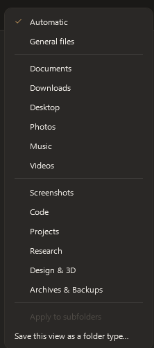
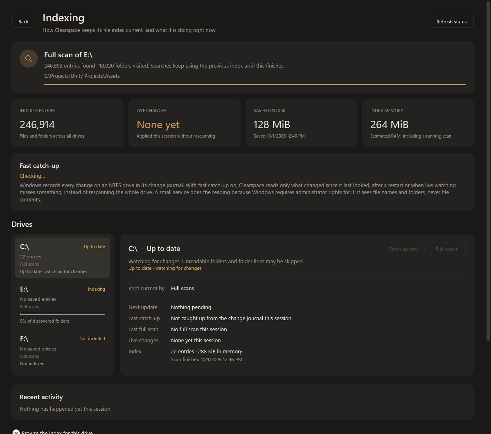
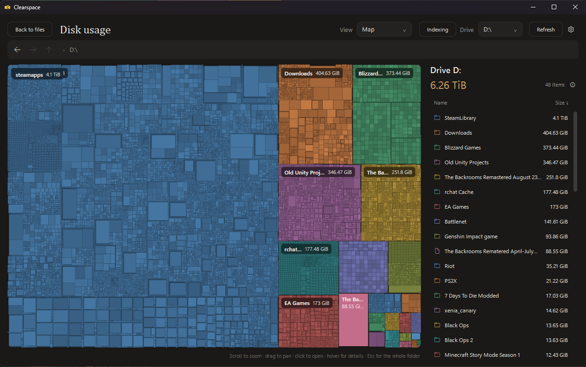
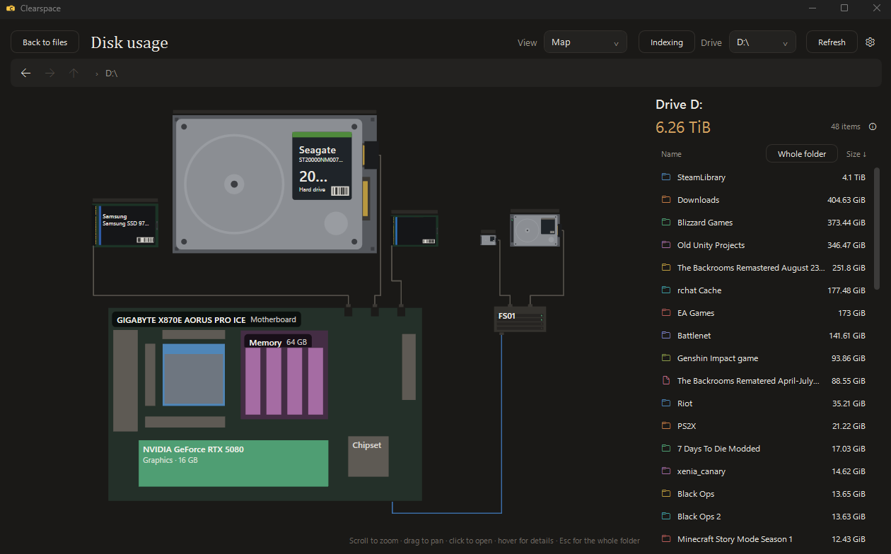
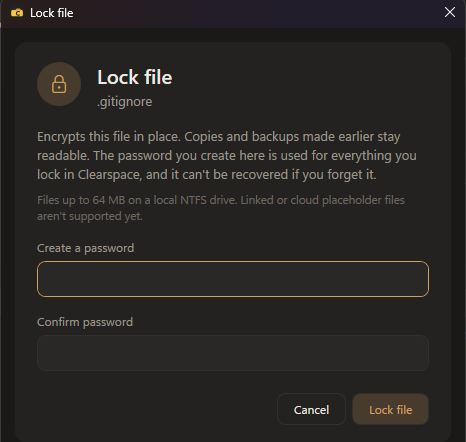
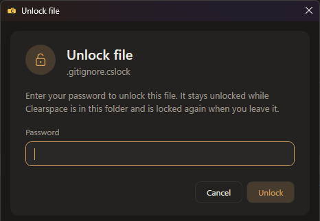

<p align="center">
  
</p>

<h1 align="center">Clearspace</h1>

<p align="center">
  <b>A modern file manager for Windows: everything File Explorer does, plus the things you wish it did.</b><br>
  <a href="https://github.com/Friday7352/Clearspace/releases/latest/download/ClearspaceSetup.exe">Download for Windows 10 and 11</a>
  ·
  <a href="#whats-new-in-170">What's new</a>
  ·
  <a href="https://github.com/Friday7352/Clearspace/issues">Report a problem</a>
</p>

> [!NOTE]
> Clearspace is still young. There will be bugs and rough edges as it meets more PCs and file collections.
> If something goes wrong, please [report it](#reporting-a-problem). Fixes and improvements keep coming.

## What is Clearspace?

Clearspace is a file manager: the program you use to open, move, copy, rename and delete your files. It works
the way you expect from File Explorer, with tabs, drag and drop, right-click menus and undo. It also adds
tools that make files easier to find, sort and look after.

It sits **beside** File Explorer and does not remove or break it. You can use both, and you can make Clearspace
the one Windows opens folders with whenever you like.

**At a glance**

- 📁 **Folders that adapt.** A photo folder opens as picture tiles, a music folder gets a player, a code folder shows Git status. Clearspace picks the [folder type](#folder-types) for you, or you choose.
- 🔎 **Search that doesn't freeze.** Results start showing at once and keep arriving, across your whole PC if you like, with [tags](#tags-and-favorites) to find things wherever they live.
- ⬇️ **A Downloads folder that helps.** Your newest downloads at the top, a way back to the page a file came from, and suggestions for where to file it.
- 🗂️ **Handy side panels.** A [preview pane](#preview-pane), an [Inspector](#inspector) with everything about a file, and a [Shelf](#shelf) to gather files from anywhere.
- 🗺️ **See what fills your drive.** A zoomable [disk usage map](#disk-usage-map), and a [duplicate finder](#find-duplicates).
- 💾 **Backups built in.** [Back up](#backup-and-restore) folders and drives on a schedule, and get earlier versions of a file back.
- 🔒 **Password locks.** [Encrypt files and folders](#password-locks) with a password, from Clearspace or from Explorer.
- 🎨 **Themes.** Many [looks to choose from](#themes), and a theme creator for making your own (in beta).

## Contents

- [Install](#install) · [Updating](#updating) · [Uninstalling](#uninstalling) · [Reporting a problem](#reporting-a-problem)
- [What's new in 1.7.0](#whats-new-in-170)
- [The basics](#the-basics) · [Keyboard shortcuts](#keyboard-shortcuts)
- [Folder types](#folder-types) · [The Downloads folder](#the-downloads-folder)
- [Search and indexing](#search-and-indexing) · [Tags and Favorites](#tags-and-favorites)
- [Preview pane](#preview-pane) · [Inspector](#inspector) · [Shelf](#shelf)
- [ZIP files](#zip-files) · [Rename several items at once](#rename-several-items-at-once) · [Find duplicates](#find-duplicates)
- [Disk usage map](#disk-usage-map)
- [Backup and restore](#backup-and-restore) · [Settings and tags backup](#settings-and-tags-backup)
- [Password locks](#password-locks)
- [Photos and music](#photos-and-music)
- [Open folders with Clearspace](#open-folders-with-clearspace)
- [Themes](#themes) · [The theme creator (beta)](#the-theme-creator-beta)
- [Where Clearspace keeps its data](#where-clearspace-keeps-its-data) · [License](#license) · [Building Clearspace yourself](#building-clearspace-yourself)

---

## Install

1. Download **[ClearspaceSetup.exe](https://github.com/Friday7352/Clearspace/releases/latest/download/ClearspaceSetup.exe)**. Earlier versions are on the [Releases page](https://github.com/Friday7352/Clearspace/releases).
2. Run it. Windows may show a blue **Windows protected your PC** notice, because the installer is not signed with a publisher certificate. Choose **More info**, then **Run anyway**.
3. Follow the steps.

**What you need:** 64-bit Windows 10 or Windows 11. Nothing else has to be installed first, and the setup file
works offline.

**What setup does:** it installs Clearspace for your Windows account only (no administrator permission needed)
and adds it to the Start menu. It offers two options:

- **A desktop shortcut.**
- **Instant indexing** (on by default) installs a small helper service that makes search indexing much faster. See [Search and indexing](#search-and-indexing). Windows asks for administrator permission once. You can turn it on or off later from the Indexing page.

### Updating

Clearspace updates itself.

- It checks quietly a few seconds after it starts and every 6 hours while it is open. When there is a new version, an **Update available** chip appears in the status bar. It never interrupts you.
- Click the chip, or choose **Settings > Check for updates…**, to see what changed. **Update now** downloads the new installer, checks it against the size and SHA-256 fingerprint GitHub lists for it, installs it and opens Clearspace again. **Later** keeps the chip; **Skip this version** hides it until something newer comes out.
- The check is one request to GitHub. Nothing about your PC is sent. Turn off **Check for updates automatically** in **Settings > About Clearspace…** to stop it.

<details>
<summary><b>Updating by hand, going back to an earlier version, and silent installs</b></summary>

**By hand:** download the newer `ClearspaceSetup.exe` and run it. Setup sees the installed Clearspace and offers:

- **Update** (or **Repair** for the same version): replaces the app and keeps settings, tags, the saved index and locked files. Clearspace is closed first, and anything unlocked for a visit is locked again.
- **Update and choose the options again**: the same, plus the page with the shortcut and Instant indexing options.
- **Remove Clearspace**: starts the uninstaller.

Copies of Clearspace older than 1.2.0 have no update check, so they need the newest installer run once by hand.

**Going back:** if a new version gives you trouble, **Settings > About Clearspace… > Earlier versions…** lists the
releases before yours. **Go back to this** installs that release over the current one, checked the same way as an
update. Your settings, tags and locked files are kept. Clearspace then only announces releases newer than the one
you went back to. Versions before 1.2.0 are not offered. If **Open folders with Clearspace** is on and the older
version doesn't have it, it is turned off first, so folders open in File Explorer again.

**Silent install:** `ClearspaceSetup.exe /VERYSILENT` performs the plain update.

</details>

### Uninstalling

Uninstall Clearspace from Windows Settings like any other app, or run the setup again and choose **Remove
Clearspace**. This removes the app, its shortcuts, its entries in Explorer's right-click menu, the lock icons, the
"Open folders with Clearspace" setting and the Index Helper service.

**Your own files are never removed.** Before anything goes, the uninstaller asks up to two questions:

1. **Locked files** (only if something is still locked): **Remove the locks first** asks for your password and decrypts everything. **Leave them locked** uninstalls anyway. Locked files stay encrypted and can't be opened until Clearspace is installed again (then they open with the same password).
2. **Your data**: **Keep my data** leaves your tags, folder types and settings for a later install. **Remove everything** deletes them. If anything is still locked, the lock records are kept either way.

A silent uninstall asks nothing and leaves locks and data alone.

### Reporting a problem

Choose **Settings > About Clearspace…** and press **Copy details**. Paste that into a new issue on the
[Issues page](https://github.com/Friday7352/Clearspace/issues), with what you were doing when it went wrong.

Two small logs in `%APPDATA%\Clearspace` can help. They stay on your PC unless you send them:

- `search-trace.log`: when searching is slow. It records how long each step of a slow search took, never what you typed.
- `just-arrived-trace.log`: when the Downloads folder's **Just arrived** strip misbehaves. It records what the strip decided and why, with the names and dates of your newest downloads.

---

## What's new in 1.7.0

- **Theme creator (beta).** Make your own theme on the Clearspace window itself, with your own files in it. Restyle any part, move parts around, add patterns, gradients, stickers and effects, and share your theme as a code or a file. [More below](#the-theme-creator-beta). *It is still in beta, so expect bugs.*
- **Custom layouts.** Themes can rearrange the whole window, including several file lists side by side, a browser look or a dashboard.
- **Undo and redo.** **Ctrl+Z** puts back a move, copy, rename, delete or new folder. **Ctrl+Y** does it again.
- **Inspector** (**Alt+I**): everything about a file or folder, including a folder's real size and a file's fingerprint.
- **Shelf** (**Alt+S**): gather files from anywhere, then move, copy or zip them all at once.
- **Toolbar buttons light up** while their panel is open (preview pane, Inspector, Shelf).
- **File Explorer works normally again** with **Open folders with Clearspace** on. Folders you open inside an Explorer window stay in Explorer.
- **Just arrived** in Downloads now always shows your newest downloads, and appears straight away instead of sometimes not at all.
- **Easier to read:** column headings, sidebar labels and status text have more contrast, and toolbar labels make room in a narrow window.

---

## The basics

Everything you'd expect from a file manager works the way it does in File Explorer:

- **Getting around:** Back, Forward, Up, the address bar (click it, or press **Ctrl+L**, to type a path), the clickable path, and your mouse's side buttons.
- **Tabs:** **Ctrl+T** for a new tab, or middle-click a folder to open it in one. Drag files onto a tab to move them there. Each tab keeps its own history, search, scroll position and selection.
- **More windows:** **Ctrl+N** or **Open in new window**.
- **Files:** copy, cut, paste, rename, new folder, delete to the Recycle Bin and Properties, with Windows' own copy and "replace or skip" dialogs.
- **Undo and redo:** **Ctrl+Z** puts back the last move, copy, rename (one item or several), delete to the Recycle Bin, or new folder or file. **Ctrl+Y** does it again. They are also at the top of the menu you get by right-clicking empty space. Clearspace keeps the last 50 changes until it closes. If something was moved, renamed or deleted since by another program, it is left alone and the status bar says so. Deleting for good (**Shift+Delete**) can't be undone.
- **Drag and drop:** drag files onto a folder in the list, the sidebar or a tab to move or copy them. Hold a file near the top or bottom of the list, or turn the mouse wheel, to scroll while dragging.
- **Drag to select:** drag a rectangle across empty space to select everything it touches. Hold **Ctrl** to add or remove, **Shift** to only add. **Esc** puts the selection back.
- **A right-click menu that fits:** **Play** for a song, **View** for a picture, **Extract** for a ZIP file, **Run as administrator** for a program, **Open file location** for a shortcut, **Print** for documents and pictures, **Set as desktop background** for a picture. Cut, copy, paste, rename and delete sit as a row of icons at the bottom. Entries that wouldn't do anything are left out.
- **Always up to date:** when another program adds, changes, renames or removes a file in the folder you're looking at, the list updates by itself, without pressing F5.
- **Drives come and go live:** a USB stick or external drive appears in the sidebar and on This PC the moment you plug it in, and goes when you remove it.
- **Network drives:** open **Network** in the sidebar and choose **Map network drive…** to give a shared folder (`\\server\share`) a drive letter. Windows asks for any password in its own sign-in box, so Clearspace never sees it. Right-click a mapped drive and choose **Disconnect** to remove it.
- **Your files:** the sidebar's home for Desktop, Documents and the rest. Add folders of your own there.
- **Views you keep:** each folder remembers its column order and widths and its tile size (**Ctrl+mouse wheel**). **Ctrl+Shift+V** switches between the list and tiles.

### Keyboard shortcuts

| Keys | What they do |
|---|---|
| **Alt+Left** / **Alt+Right** / **Alt+Up** | Back / Forward / Up |
| **Alt+Home** | Your user folder |
| **Ctrl+L** | Type a path in the address bar |
| **Ctrl+F** | Search |
| **F5** | Refresh |
| **Enter** | Open |
| **F2** | Rename (with several items selected: [rename them all](#rename-several-items-at-once)) |
| **Ctrl+C** / **Ctrl+X** / **Ctrl+V** | Copy / Cut / Paste |
| **Ctrl+Shift+C** | Copy path |
| **Ctrl+Shift+N** | New folder |
| **Delete** / **Shift+Delete** | Delete to the Recycle Bin / delete for good |
| **Ctrl+Z** / **Ctrl+Y** | Undo / Redo |
| **Alt+Enter** | Properties |
| **Ctrl+A** / **Ctrl+Shift+I** / **Esc** | Select all / invert the selection / clear it |
| **Ctrl+T** / **Ctrl+W** | New tab / close tab |
| **Ctrl+Tab** / **Ctrl+Shift+Tab** | Next / previous tab |
| **Ctrl+1** … **Ctrl+8**, **Ctrl+9** | Go to that tab, or the last one |
| **Ctrl+Shift+T** | Reopen the tab you closed |
| **Ctrl+N** | New window |
| **Ctrl+Shift+V** | Switch between list and tiles |
| **Alt+P** / **Alt+I** / **Alt+S** | Preview pane / Inspector / Shelf |
| **Ctrl+`** | Open a terminal in this folder |

---

## Folder types

Every folder has a **type**, chosen from the folder type button in the toolbar. The type decides how the folder
opens (tiles or a list), which columns it shows, how it is sorted and grouped, and what extras it gets, such as the
photo viewer or the music player.



Leave a folder on **Automatic** and Clearspace picks for you. The toolbar shows what it picked, such as
**Auto (Photos)**. It looks, in this order, at:

1. **Windows' own folders.** Desktop, Documents, Downloads, Pictures, Music, Videos and Screenshots, wherever they have been moved to.
2. **The folder's name.** "Camera roll" opens as Photos, "Old backups" as Archives & Backups, and so on.
3. **Code.** A `.git` folder, a solution or project file, or a file such as `package.json` in the folder or above it.
4. **What's inside.** Once opened, a folder where most files (60 %) are one kind takes that type.

**Apply to subfolders** makes your choice cover every folder inside it, unless one has a type of its own.

<br clear="right">

| Type | Opens as | What it adds |
| --- | --- | --- |
| **General files** | A plain list | Nothing extra: a fast list. Cloud folders also show each file's sync status. |
| **Documents** | List with pages and authors | Page counts and authors, read from the files themselves. |
| **Downloads** | List, newest first | Grouped by day, the site each file came from, and the [Downloads extras](#the-downloads-folder). |
| **Desktop** | List | Folders, shortcuts and files in their own groups. |
| **Photos** | Picture tiles | The [photo viewer](#photos-and-music) and picture sizes. |
| **Music** | List with artist, album and length | The built-in [music player](#photos-and-music). |
| **Videos** | Video tiles | Each tile shows the video's length; the list adds resolution. |
| **Screenshots** | Picture tiles, newest first | Everything Photos does, grouped under Today, Yesterday, This week… |
| **Code** | List with a Git column | The Git branch, how many files changed, each file's Git status, and build folders (`bin`, `obj`, `node_modules`) dimmed. |
| **Projects** | List with tags | A strip of files you pinned to the project and files changed most recently inside it. Choose it yourself. |
| **Research** | List with title, authors and pages | Papers by their real title and authors, so `2304.12345.pdf` reads as a paper. |
| **Design & 3D** | Large tiles | Big previews (3D models too, where Windows can draw them), the photo viewer and pixel sizes. |
| **Archives & Backups** | List, newest first | Grouped by date, and its contents rank below your current files in search. |

The type only sets where a folder starts. You can still change its columns, sorting and layout.

- **Save this view as a folder type…** keeps a folder's layout, columns, sort and tile size as a type of your own (for example "School"). It keeps the extras of the type it was made from.
- Select several folders and right-click to set their type together.
- Search understands types: `screenshots receipt` or `type:school essay`.

## The Downloads folder

Folders of the **Downloads** type get four extras.

**Just arrived.** A strip above the list shows your five newest downloads as tiles, with buttons for what you
usually do next: open, unpack (a `.zip`), open the page it came from, move or delete. Click a tile to find the file
in the list, or drag it into a chat, an e-mail, onto the desktop or onto a folder. A file counts from when it
reached your PC, so a download with an old date (a driver from 2019, say) still shows at the top. The **×** hides
the strip; right-click empty space in the list and choose **Show just arrived** to bring it back.

**Go back to the page.** Right-click a downloaded file and choose **Open the page this came from**, or **Copy
download link** for the file's own address. This works in every folder, for files that still carry the note
Windows attaches to downloads.

**Suggested folders.** Clearspace notices where you move your downloads. After files from the same site, or of the
same kind, have gone to one folder a couple of times, the next one like them offers **Move to "that folder"**. It
only suggests; nothing moves until you click. **Move…** opens a folder chooser that recommends up to three folders
and says why. Right-click a tile and choose **Stop suggesting** to make it forget a folder. Only counts of moves
are remembered, never file names or web addresses.

**Installers.** The strip counts the setup files in the folder and how many are for programs you already have.
**Review** lists them: ones that **look installed** are ticked, ones **newer than what you have** (an update you
haven't run yet) and ones **not found** are not. Change the ticks and choose **Move to Recycle Bin**. The match is
made by name against Windows' *Installed apps* list. It tells you a program is installed, not that a file is safe.

## Search and indexing

Type in the search box (**Ctrl+F**) and results start at once:

1. The folder you're in is filtered immediately.
2. Its subfolders are searched in the background, and more results stream in without freezing the window.
3. If you turn it on, Windows' own search index adds fast results, including words inside documents.

**Search Everywhere** widens the search to all your drives. Network drives are left out of that, so a slow share
can't stall it.

```text
tag:work        items with the Work tag
type:photos     folders set to the Photos type
ext:png         PNG files
is:folder       folders only
is:image        pictures only
```

**Clearspace's own index.** Clearspace keeps an index of file names, sizes and dates, so search and the disk map
never wait for a walk of the disk. The optional **Index Helper** service (the *Instant indexing* option in setup)
makes it fast:

- **Instant first index:** it reads the drive's file table directly, so millions of files take seconds rather than minutes.
- **Fast catch-up:** after a restart it reads only what changed since last time, instead of rescanning the drive.

The helper sees file names and folders, never what's inside your files, and only returns what your own account can
open. Without it (and on network drives or drives that aren't NTFS), Clearspace scans folders instead and rescans
once a day. The index takes about 100 MB of memory per million files.

<details>
<summary><b>The Indexing page</b></summary>

Open **Indexing** from the toolbar, the disk usage map or the index status indicator to see:

- what the index is doing right now (the drive and folder being scanned, with live counts);
- totals: entries, changes applied this session, the saved index's size and an estimate of its memory use;
- **Fast catch-up**, with **Turn on** and **Turn off**;
- each drive's status, how it is kept current, its next update and its last scan, with progress bars during a scan;
- **Catch up now** (only what changed), **Full rescan** (everything, in the background) and **Refresh status**;
- recent activity, the folders the last scan skipped and why, and where the index file is saved;
- **Browse the index for this drive**, in pages of up to 1,000 entries.



</details>

## Tags and Favorites

**Tags** are labels you put on files and folders, so you can group things that live in different places without
moving them. Create, apply, remove and delete tags from the right-click menu, then search by a tag's name or with
`tag:work`.

**Favorites** in the sidebar hold the places you visit most. Sort them into your own categories, which you can
collapse and reorder.

Tags are kept on your PC in `%APPDATA%\Clearspace\tags.db`. To keep them safe, see
[Settings and tags backup](#settings-and-tags-backup).

## Preview pane

Press **Alt+P**, or the preview button in the toolbar, to see the selected item beside the list without opening
it: pictures, videos and documents Windows can draw (a PDF's first page, for example), the first lines of any text
file, and what's inside a `.zip`. Underneath are its type, size, dates, tags and folder. With several items
selected it shows how many and their total size.

A cloud file that isn't on your PC is never downloaded just to preview it, and a locked file isn't opened.

## Inspector

Press **Alt+I**, or the **(i)** button, for everything about the selected file or folder:

- its name, type and size to the byte;
- a **folder's real size**, counting everything inside it as you watch;
- a picture's size in pixels, a song's or video's length, a document's pages;
- when it was made, changed and last opened, the program that opens it, its tags, its Git state, and whether it is read-only, hidden, compressed or encrypted;
- **Copy path**, and its **Fingerprint** (SHA-256), to check a download or that two files are the same. Click it to copy it.

With several items selected it shows how many, their total size, what kinds they are, and the oldest and newest
change.

## Shelf

Press **Alt+S**, or the shelf button. The shelf collects files from anywhere so you can deal with them together:

1. Drop files on it from the list, the desktop or another program, or right-click and choose **Add to shelf**.
2. Go to the folder they should end up in.
3. Press **Move**, **Copy** or **Zip**.

You can also drag things off the shelf, one at a time or all at once with **Drag all**. The shelf only remembers
where things are; nothing is copied until you say so, and it is still there after a restart. **Clear** takes
everything off the shelf and leaves the files where they are.

The Inspector and the Shelf share a column on the right of the window. Drag its edge to make it wider. The
toolbar buttons for the preview pane, Inspector and Shelf light up while their panel is open.

## ZIP files

Double-click a `.zip` and it opens like a folder, without extracting anything. Back, Up, tabs, sorting and search
all work inside it.

- **Double-click a file** to open a copy of it. Changes you make aren't saved into the ZIP.
- **Copy** or **drag** files out of it, into a folder, onto the desktop or into another program.
- **Extract all** in the toolbar unpacks the whole ZIP into a new folder beside it.
- Right-click `.zip` files for **Extract to "name"** (a new folder beside each) or **Extract to…** (a folder you choose). Nothing that is already there is overwritten.
- Right-click any files and choose **Compress to ZIP file** to pack them into a new `.zip`.

The inside of a ZIP can be looked at and copied from, not changed: to change it, extract it, change it and
compress it again. Password-protected ZIPs aren't supported yet.

**7z, RAR and TAR files** can be extracted too: right-click one for **Extract to "name"** or **Extract to…**, the same
as a ZIP. This covers `.7z`, `.rar` (including sets split into `.part1.rar`, `.part2.rar`… — keep all the parts in
one folder and extract the first), `.tar`, `.tar.gz`, `.tar.bz2`, `.tar.xz` and `.tar.zst`. The preview pane lists
what's inside a `.7z` or `.rar`. These don't open like a folder the way a ZIP does, and password-protected ones
aren't supported yet.

## Rename several items at once

Select several files or folders and press **F2**. A window shows every old name beside its new one before anything
changes:

- **New name** is a pattern: `{name}` is the current name, `{n}` a number (`{n:3}` gives 001) and `{date}` the date modified. `Holiday {n}` gives *Holiday 1.jpg*, *Holiday 2.jpg*…
- **Find** and **replace with** change a piece of text in every name.
- **Capitals** switches names to small letters, capitals, or Each Word.

File endings are kept. Names that can't be used are marked, and nothing is renamed until all of them are fine.
**Ctrl+Z** puts every old name back.

## Find duplicates

Press **Find duplicates** in the toolbar, or right-click a folder and choose **Find duplicates…**. Clearspace finds
files that are exact copies of each other, byte for byte, whatever they're called, and lists them in groups with the
biggest waste of space first.

- Tick the copies you don't want, or use **Keep the newest of each** or **Keep the oldest of each**, then **Move to Recycle Bin**.
- **One copy always stays.** The last one in a group can't be ticked.
- Every ticked file is checked again just before it is removed, and anything that changed is left alone.
- **Look in subfolders too** is on by default.

On a drive Clearspace has indexed, the search starts from the index and only reads files that could be copies, so
it is much faster. **Search the disk instead** runs the full, slower search.

## Disk usage map

Press **Disk usage** in the toolbar to see what fills your drive. The whole drive is drawn as nested blocks, each
sized by how much space it takes, beside a list of the biggest items.



- **Click a block** to fly into that folder. **Scroll** to zoom at the pointer, **drag** to pan, and zoom out to leave a folder. Back, Up and the path follow along.
- **Hover** a block for its size, share and file type.
- **Delete for good** from the map: right-click a block, or select items in the list and press **Shift+Delete**. A confirmation lists what will go.
- **Back to files** returns to your files.

Keep zooming out and you see your other drives, each drawn as the device it is (an NVMe stick, an SSD, a hard
drive, a USB enclosure), cabled to your actual motherboard with its processor, memory and graphics card. Zoom into
the memory to see which programs are using it, or into the processor to see its cores and how busy each one is.



<details>
<summary><b>Map settings and experimental views</b></summary>

The gear beside **Refresh** opens the map's settings. They are remembered.

- **GPU acceleration** draws the map with your graphics card.
- **Low performance mode** draws only the folder you're in, for integrated graphics or enormous folders.
- **Conserve memory** keeps less in memory and draws fewer blocks at a time.
- **Build in the background** keeps reading the rest of the drive while you look at part of it.
- **Render everything** (experimental) draws every block at every depth at once, so nothing pops in as you zoom. It needs more memory in very large folders.
- **Index network drives** adds mapped network drives (a NAS, a share) to the index, the map and search. A share is only read while it answers.
- **Experimental views** adds a **View** picker: **3D blocks** (the folder as a field of blocks you can orbit), **Disk layout** (where the largest files physically sit on the drive) and **3D city** (folders as towers you can walk into).

Press **F3** in the map to see how fast it is drawing on your PC. The map shows a snapshot of the index, so very
recent changes may be missing until it refreshes.

</details>

## Backup and restore

**Settings > Backup and restore…** copies files, folders and whole drives to another place and keeps those copies
up to date, by hand or on a schedule. You can also right-click any file, folder or drive and choose **Back up…**.

**New backup** asks what to back up, where to save it, how often, and how much to keep. **Contents** sets it up for
you: say what's in the folder and Clearspace picks the options that suit it.

| Contents | What is set | Why |
|---|---|---|
| **Documents** | Keep the last 30 backups | Small files that change often. You can go back to before a file was overwritten or damaged. |
| **Photos & media** | One copy; deleted or changed files are kept for 90 days | Big files that rarely change, so one copy is enough, and a photo deleted by mistake can still be had back. |
| **Projects** | Keep the last 10 backups, skip rebuilt folders | Folders such as Unity's `Library` or `node_modules` are made again when you open a project, so leaving them out makes backups far smaller. |
| **A mix** | One copy; deleted files are kept for 30 days | A bit of everything, or a whole drive. |

- **Save it to another drive.** Clearspace recommends external drives, puts drives that already hold your backups first, and warns when a backup would be on the same drive as the original.
- **Zip to save space** packs each run into one `.zip`. It suits documents; photos and videos hardly shrink.
- **Scheduled backups** run while Clearspace is open, and also while it's closed if you turn that on. A backup that was due while the PC was off, or whose drive wasn't plugged in, runs as soon as it can.
- **Interrupted?** A power cut, a shutdown or a pulled drive doesn't start a backup over. The next run carries on from where it stopped, and even a long zip loses at most its last half minute.

**Getting files back**

- **Restore…** on a backup puts a copy back where it came from or into another folder. Restoring never deletes anything.
- **Earlier versions…** in a file's right-click menu lists every saved state of that file. **Restore** puts one back (the current file goes to the Recycle Bin first), or **Save a copy** puts it beside the file.
- A backup is also just a folder: **Open the backup's folder** shows it in Clearspace.

<details>
<summary><b>More about backups: the four kinds, what is kept, and good to know</b></summary>

| Kind | What a run does | Good for |
|---|---|---|
| **Clone** | Makes the backup the same as the original, using Windows' own fast copy (`robocopy`). | Large folders and drives. |
| **Add and update** | The same, but nothing is ever removed from the backup. | Folders you tidy up but want everything kept from. |
| **Versions** | Makes a dated folder that looks like a full copy; unchanged files take no extra room (on NTFS drives). | Going back to how things were on a given day. |
| **Zip archive** | Makes one dated `.zip`. | Small folders, and backups you want to send somewhere. |

**Keep** decides how many runs stay: **Latest only**, the **last 5, 10 or 30**, or every run of the last **30 days,
90 days or year**. The newest run is never deleted.

Under **More options**:

- **Files it removes** (Clone): a file gone from the original moves to an *Earlier versions* folder instead of being deleted.
- **Earlier versions of changed files** (Clone, Add and update): the old copy is kept before a changed file replaces it.
- Both are kept for 30 days, 90 days, a year or forever.
- **Skip**: folder names left out. For projects, Clearspace skips only what it found a reason for (`Library`, `Temp`, `Logs`, `obj`, `.vs`, `node_modules`, `__pycache__`, `Intermediate`, `DerivedDataCache`, `.godot` and similar). Take a name out if a folder with that name holds something you made.

Good to know:

- Each backup gets its own folder, and Clearspace only ever changes things inside it.
- A drive backup copies its files. It isn't an image Windows can start from.
- On exFAT and FAT sticks every dated copy is stored in full, so Clearspace keeps one copy plus earlier versions there instead.
- OneDrive files that are online-only are left out unless you tick **Include cloud files that are not on this PC**, because copying them downloads them first.
- Links to other folders aren't followed. A Clone refuses to run if the original has become completely empty, rather than emptying the backup.
- Against ransomware, a backup only helps if the ransomware can't reach it: unplug the backup drive when you're not using it.
- Locked files are copied still locked. A file unlocked for a visit is copied unlocked if a backup runs during the visit, so leave folders with locked files out of scheduled backups if that matters.

</details>

## Settings and tags backup

**Settings > Back up settings and tags…** keeps a copy of what Clearspace itself holds: your settings (pins, the
sidebar, folder types, columns, theme and the rest) and your tags. Your files aren't copied, and nothing about
password locks is.

- **Back up now** makes one straight away. Give it a label if you like, such as *Before reinstalling Windows*.
- **Automatic backup** makes one every day, every week, or as often as you choose, and keeps as many as you say. They go to `Documents\Clearspace Backups` unless you choose somewhere else. A folder OneDrive syncs keeps them safe if the PC is lost.
- **Restore…** puts back your tags (on the files that still exist), your settings, or both. **Restore from a file…** uses a backup from a USB stick or another PC.

Before a restore changes anything, Clearspace backs up how things are now, so a restore can be undone too.

## Password locks

Right-click a file or folder and choose **Lock with password…** to encrypt it with AES-256. The first lock creates
your password. **Keep it safe: it can't be recovered.**

<p>
  
  
</p>

- **Files** become `<name>.cslock` with a lock badge. Opening one asks for the password; it stays unlocked until no window is showing its folder, then locks again.
- **Folders** have every file inside encrypted; names stay visible. Opening the folder asks for the password, and everything locks again when you leave.
- **Remove lock…** decrypts for good. **Settings > Remove all locks and reset password…** unlocks everything and lets you choose a new password.
- **Locks travel with the files.** After a reinstall, a Windows reset or on another PC, they still open with the password they were locked with. If that's an older password, Clearspace offers to switch them to your current one.
- **Limits:** local NTFS drives only. Files over 64 MB, links, cloud placeholders, files in use and a few others are skipped and listed. Drive roots, your user folder and Windows folders are refused. Copies and backups made before locking aren't encrypted.

<details>
<summary><b>Using locks from File Explorer</b></summary>

The same actions are in Explorer's right-click menu (under **Show more options** on Windows 11), and locked items
get lock icons there too.

| In Explorer | What happens |
| --- | --- |
| Right-click a file, **Lock with Clearspace** | The password window opens and the file is locked. |
| Double-click a `.cslock` file | Asks for the password, unlocks it and opens it in its usual program. |
| Right-click a `.cslock` file, **Unlock with Clearspace** | Unlocks it for now, without opening it. |
| Right-click a `.cslock` file, **Remove lock with Clearspace** | Decrypts it for good. |
| Right-click a `.cslock` file, **Change password with Clearspace** | Switches a file locked with an older password to your current one. |
| Right-click a folder, **Clearspace**, then **Lock folder**, **Unlock folder**, **Remove lock** or **Change password** | The same for everything in the folder. |
| Right-click a folder, **Clearspace**, **Open in Clearspace** | Opens the folder in Clearspace. |

Unlocking is for a visit. Clearspace runs quietly in the background and locks things again a few seconds after no
Explorer or Clearspace window is showing their folder. Anything left unlocked by a crash or shutdown is locked again
the next time Clearspace starts. Explorer can still list a locked folder without a password, but all it shows are the
encrypted `.cslock` files.

</details>

## Photos and music

**Photo viewer.** In a Photos folder, open a picture to browse the folder, zoom and pan without leaving Clearspace.
You can rotate a picture or crop it, saving in place where the format allows, or as a copy.

**Music player.** In a Music folder, play songs right in Clearspace, with artist, album, track number and length
read from the files. Double-click still opens a song in its usual program.

## Open folders with Clearspace

Turn on **Settings > Open folders with Clearspace** and folders you open from the desktop, from other programs or
with **Win+E** open in Clearspace instead of File Explorer, in a new tab of the window you already have.

- It applies to your Windows account only and needs no administrator permission.
- **File Explorer keeps working as it always has.** A folder you open inside an Explorer window stays in that window. To take a folder from Explorer into Clearspace, right-click it and choose **Clearspace > Open in Clearspace**.
- **Show in folder** in other programs (a browser's downloads list, an editor's "Reveal in File Explorer") opens the folder in Clearspace with the file selected.
- The file pickers inside other programs don't change, and programs that start Explorer by name still get Explorer.
- Untick the setting to switch back. Uninstalling switches back too.

---

## Themes

Open **Settings > Choose a theme…** to see every theme as a small window in its own colors, and click one to use it.
It applies at once to every Clearspace window and is remembered.

| Theme | What it looks like |
| --- | --- |
| **Dark** | The default: warm dark greys with an amber accent. |
| **OLED Black** | True black, so an OLED screen switches those pixels off. |
| **Light** | Warm paper tones. |
| **Blueprint** | A drafting sheet: deep navy, white and pale-cyan lines. |
| **Terminal** | A green-phosphor screen, monospace everywhere. |
| **Retro** | The classic 1998 desktop: grey chrome, navy highlights, square corners. |

The **Experimental** themes go further and change icons, fonts and shapes too: **Pixel** (a 16-bit console menu),
**DOS Commander** (the blue two-panel file managers of the DOS years), **Wireframe** (outlines only), **Neon HUD**
(a sci-fi display), **Glass** (the glossy late-2000s look), **Sketchbook** and **Sketchbook (dark)** (pencil on
paper, or chalk on black), **Type tiles** (every file a colored tile with its extension), **Zen** (as little as
possible), **1-bit Mac** and **1-bit Mac (dark)** (a 1984 desktop), and **E-reader** (an e-ink display).

Windows' own dialogs, such as file Properties, keep the Windows look in every theme.

**Adding and removing themes.** Every theme is one file in the **Themes** folder next to `Clearspace.exe`. To add one
somebody made, choose **Import…** on the Themes page (or **Paste code** for a theme sent as a code). To remove one,
click the bin on its card; it goes to the Recycle Bin. **Dark** can't be removed, so there is always one theme.

**Themes are safe to share.** A theme can only change how Clearspace looks. Clearspace checks every theme, code and
deck file before using it and refuses anything that isn't colors, fonts, shapes, pictures and layout, so a theme
from someone else can't run a program or read your files.

Updating Clearspace replaces its own theme files and leaves yours alone. To change a built-in theme, work on a
copy under another name.

### The theme creator (beta)

> [!WARNING]
> **The theme creator is in beta.** It is new and still being worked on, so there can be a lot of bugs:
> things that don't look right, settings that don't stick, or a window that behaves oddly while you're editing.
> Your files are never at risk (a theme can only change how Clearspace looks), and **Cancel** always puts your old
> theme back. If something goes wrong, please [report it](#reporting-a-problem).

Choose **Create a theme…** on the Themes page, or right-click a theme and choose **Edit theme…**. The Clearspace
window itself goes into edit mode, with your own files in it, so you see exactly how your theme will look. A panel
opens on the right and a bar across the top. Nothing is saved until you press **Done**, and **Cancel** puts
everything back.

**Two modes**, switched on the top bar:

- **Style** is for how things look. **Click any part of the window** (the sidebar, toolbar, tabs, file area, status bar…) to change its color, outline, see-through, pattern or corners. Right-click anywhere to see every color and font that spot uses.
- **Arrange** is for where things go. **Drag any part of the window** to move it. The window rearranges as you drag, so what you see is what you get. Let go to keep it, or press **Esc** to put it back.

**Your theme is a hand of cards**, shown along the bottom: its colors, panels, patterns, fonts, layout, stickers,
effects and icons. Click a card to change it. **Add a card** makes new ones:

- a **pattern** or a **gradient** on the window or any panel (draw your own with the **pattern maker**);
- a **font**, a **layout** or an **icon style**;
- an **effect**: scanlines, film grain, a vignette, a glow, a notebook spiral, warning tape and more;
- a **sticker**, or a **picture behind the files**. The picture editor can **remove a background** in one click and crop;
- **your own icon** for a file type, a file name or all folders.

**Borrow cards** from any other theme: take the colors from one, the stickers from another and the layout from a
third. Keep cards you like in **My cards** to use again.

**Start from something.** The **Theme** tab offers six moods, **Surprise me**, a picture, your wallpaper or another
theme as a starting point.

**Custom layouts.** **Build a custom layout…** lets you rearrange the whole window: several file lists side by
side, a browser look, a dashboard, text, pictures and a clock. Start from **Classic**, **Dual pane**, **Browser**,
**Dashboard**, **Four panes** or **Focus**. The extra file lists are made for moving files: drag between them,
use copy and paste, and delete.

**Share it.**

- **Copy code** (one card) or **Copy deck code** (the whole theme) copies a line of text starting with `CS-` to paste in a chat or a forum. Codes can't carry pictures or font files, and Clearspace says what was left out.
- **Save deck file…** saves everything in one `.csdeck` file, pictures and fonts included.
- **Share** on the top bar saves the finished theme as a theme file you can send to anyone.

The top bar also has **Undo** and **Redo** (**Ctrl+Z**, **Ctrl+Y**), and a warning when some text is hard to read on
your colors, with a **Fix** button. **Ctrl+S** saves; **Esc** lets go of things one at a time. A built-in theme is
saved as a new theme of your own; to change one you made, right-click it and choose **Edit theme…**.

Prefer editing files by hand? A theme file is an ordinary zip with `theme.json` and `theme.xaml` inside.
[Making a Clearspace theme](docs/Making-a-theme.md) has the steps and every setting a theme can hold.

---

## Where Clearspace keeps its data

| What | Where |
|---|---|
| Settings, tags, folder types, logs | `%APPDATA%\Clearspace` |
| The saved index, lock icons | `%LOCALAPPDATA%\Clearspace` |
| Theme creator fonts, saved colors and kept cards | `%LOCALAPPDATA%\Clearspace\ThemeStudio` |
| Themes | The **Themes** folder next to `Clearspace.exe` |
| Settings and tags backups | `Documents\Clearspace Backups`, unless you chose elsewhere |

Everything stays on your PC. The only thing Clearspace sends anywhere is the update check to GitHub, which you can
turn off.

## License

Clearspace is released under the [MIT License](LICENSE). The two pixel fonts it includes are under the SIL Open
Font License; their licence texts are with them in `Clearspace/Themes/Pixel/fonts` and inside the Pixel theme file.

## Building Clearspace yourself

The source code is in this repository. To build Clearspace, publish a release, or see how it is put together, read
[DEVELOPMENT.md](DEVELOPMENT.md).

---

<p align="center">Thanks for trying Clearspace! It's still early, so bugs and missing features are expected. I'll keep adding and fixing things as I can.</p>
